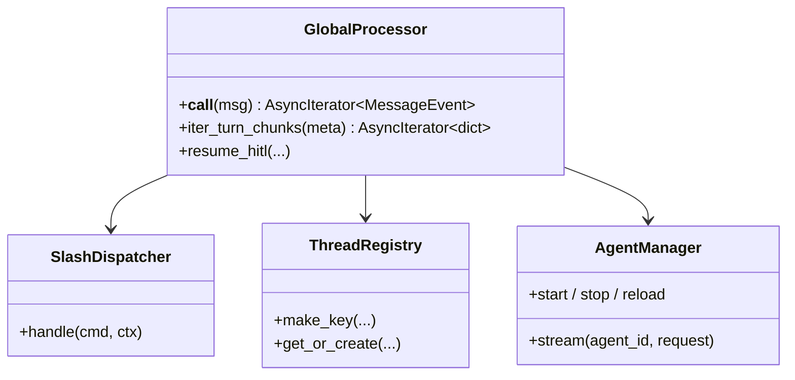

# `agent-runtime`（统一消息处理与 Agent 编排引擎）

`src/octop/infra/gateway/process/processor.py` 的 `GlobalProcessor` 是全仓唯一消息处理入口：Web Dashboard、IM 通道、CLI、Cron 四类触发面全部归一到同一生成器协议，装配 harness 请求后委托 `AgentManager.stream`。引擎死守「线程键确定性」「归属隔离」「写时契约闭合」三条不变量；harness-agent 内部实现为仓外黑盒。

## 1. 引擎核心不变量（Hard Invariants）

1. **线程键确定性不变量**：`ThreadRegistry.make_key` 用 `f"{agent_id}:{channel_type}:{channel_subject_id}:{channel_chat_type}"` 聚合会话（`src/octop/infra/gateway/threads.py:30`），`channel_type` 字面量 `dashboard`/`cli`，`chat_type` 为 `dm`/`group`（`:16-19`）；改键格式会使历史线程全部错位。
2. **租户归属不变量**：`GlobalProcessor.__call__` 首步校验 `msg.tenant_id`，为空直接返回 `MessageEvent.error_event("No agent (tenant_id) specified")` 并 `completed()`（`src/octop/infra/gateway/process/processor.py:523-526`），禁止跨 Agent 串话。
3. **响应模式闭合不变量**：`ChannelResponseMode = Literal["invoke","stream"]`，仅大小写不敏感的 `"stream"` 走流式，其余回落 `invoke`（`src/octop/infra/gateway/process/response_mode.py:19-24`）；`collapse_to_invoke_response` 在 `TOOL_START` 处丢弃文本缓冲（`:63`）。
4. **视觉载荷不变量**：`VISION_MAX_BYTES = 2*1024*1024`、`VISION_MAX_COUNT = 4`（`src/octop/infra/gateway/media/attachment_hints.py:44-45`），`build_content_from_message` 以 `i < VISION_MAX_COUNT` 截断（`src/octop/infra/gateway/process/harness_request.py:113`）。

## 2. 核心类型层次与职责表



| 核心符号（类 / 函数） | 源码锚点（路径:行号） | 持有的关键状态 | 职责与生命周期 |
|---|---|---|---|
| `GlobalProcessor` | `src/octop/infra/gateway/process/processor.py:92` | `_hitl`、`_dispatcher`、媒体后端 | `Gateway.boot()` 构造（`src/octop/infra/gateway/gateway.py:200`），进程级单例 |
| `ThreadRegistry` | `src/octop/infra/gateway/threads.py:13` | `thr_*` 线程 ID、`rebind` 映射 | 每次会话 `get_or_create_by_key`（`src/octop/infra/gateway/process/processor.py:639`） |
| `SlashDispatcher` | `src/octop/infra/gateway/slash/dispatcher.py:26` | `_handlers` 字典 + runtime 回退 | `build_default_dispatcher` 注册（`:83`），`CATALOG` 定义于 `src/octop/infra/gateway/slash/catalog.py:67` |
| `build_harness_request` | `src/octop/infra/gateway/process/harness_request.py:255` | `messages`/`thread_id`/`configurable`/`model` 字典 | 每轮装配一次，见 [`../integrations/topology-and-mapping.md`](../integrations/topology-and-mapping.md) |
| `project_stream` | `src/octop/infra/gateway/process/stream_project.py:231` | `StreamProjectionState.hitl_paused`（`:26`） | 把 harness chunk 投影为 `MessageEvent` |
| `AgentManager` | `src/octop/infra/agents/manager.py:298` | 状态 `starting/running/stopped/failed/created` | `_start_agent`（`:2013`）、`stream`（`:956`）、`resume_hitl`（`:981`） |

## 3. 核心处理管线与关键阈值（Pipeline & Thresholds）

```text
GlobalProcessor.__call__ (src/octop/infra/gateway/process/processor.py:517)
  ├─ [Stage 1: 准入] :523 tenant_id 空 -> error + completed；:537 parse_slash
  │    └─ approve/reject/pending -> _hitl.iter_slash_resolution (:544)
  ├─ [Stage 2: 装配] :639 get_or_create_by_key -> :649 build_content_from_message
  │    -> :654 _resolve_harness_model（reasoning 模式 auto|enabled|disabled, :497）
  │    -> :661 _resolve_turn_mcp_servers(apply_defaults=True, raise_on_failure=False)
  │    -> :686 build_harness_request -> :696 _attach_turn_knowledge_config
  ├─ [Stage 3: 执行] :706 typing -> :713 project_stream -> agent_manager.stream (:856)
  │    ├─ "hitl_required" -> register_from_request (:865)（挂起）
  │    └─ "tool_result" -> enrich_tool_result_with_backend (:880)
  └─ [Stage 4: 提交] :738-746 _touch_thread_after_turn + _record_turn_usage + _record_turn_history
       -> :747 completed()；异常 -> format_stream_error + 审计 "agent.stream.error" (:1170)
```

| 关键常量 / 算法阈值 | 代码值 | 源码位置 | 业务/性能作用 |
|---|---|---|---|
| `VISION_MAX_BYTES` / `VISION_MAX_COUNT` | `2097152` / `4` | `src/octop/infra/gateway/media/attachment_hints.py:44-45` | 限制单轮图片体积与数量，防超大多模态请求 |
| `_DECISION_TYPES` / `_MAX_DECISIONS` | `{approve,edit,reject,respond}` / `16` | `src/octop/api/routers/chat/models.py:10-13` | HITL 审批决策类型与上限 |
| `HISTORY_DEFAULT_LIMIT` / `HISTORY_MAX_LIMIT` | `25` / `200` | `src/octop/api/routers/chat/serialize.py:52-53` | 历史消息分页上限 |
| `context-usage` `max_tokens` | `128000` | `src/octop/api/routers/chat/history.py:227` | 上下文窗口估算 |
| `_MAX_LOGS` 式截断 | `error_type:"auth"` / HTTP ≥400 body ≤300 字符 | `src/octop/infra/agents/providers/probe.py:180-187` | 下游错误体截断防日志膨胀 |
| `DEFAULT_RETRIEVAL_K` / `DEFAULT_CONTEXT_CHAR_BUDGET` | `8` / `6000` | `src/octop/infra/knowledge/params.py:9-10` | 检索注入上下文预算 |

## 4. 上游调用方与出向边界

- **入向**：[`api-service.md`](api-service.md) 的 WS/SSE、`src/octop/infra/gateway/gateway.py:636` 注册的 IM 通道、`src/octop/infra/cron/delivery.py:141` 的定时任务。
- **出向黑盒**：harness-agent 的 `stream` / `resume_hitl` 为外部运行时，本仓只装配 `HarnessRequest` 字典，见 [`../overview/callchain-panorama.md`](../overview/callchain-panorama.md) 桥接表；模型探测字典见 [`../integrations/downstream/llm-provider.md`](../integrations/downstream/llm-provider.md)。
- **持久化**：线程/消息/轨迹经 `SharedServices` 的 `thread_repo`、`thread_message_repo`、`trajectory_event_repo`（[`data-and-adapter.md`](data-and-adapter.md)）。

## 5. 共变耦合与修改清单（Co-Change Playbook）

- **新增斜杠命令**：改 `src/octop/infra/gateway/slash/catalog.py:67` 的 `CATALOG` → 在 `slash/handlers/` 实现 → 核对 `src/octop/infra/gateway/slash/dispatcher.py:35` 分发 → 同步 `src/octop/i18n/{en,zh}.json` 文案 → 跑 `uv run pytest tests/unit/gateway -q`。
- **改 `HarnessRequest` 字典键**：改 `src/octop/infra/gateway/process/harness_request.py:255` → 核对 `src/octop/infra/gateway/process/processor.py:686` 与 `_build_dashboard_request`（`:964`）注入点 → 更新 [`../integrations/topology-and-mapping.md`](../integrations/topology-and-mapping.md)。
- **改线程键/状态机**：同步 `src/octop/infra/gateway/threads.py:30`、前端 `chatStore` 与 `tests/unit/gateway/`，禁止只改一侧。
- **必跑回归**：`uv run pytest tests/unit/gateway tests/unit/agents -q`；改 SSE/WS 帧另跑 [`../operations/dev-and-test.md`](../operations/dev-and-test.md) 列出的集成用例。
