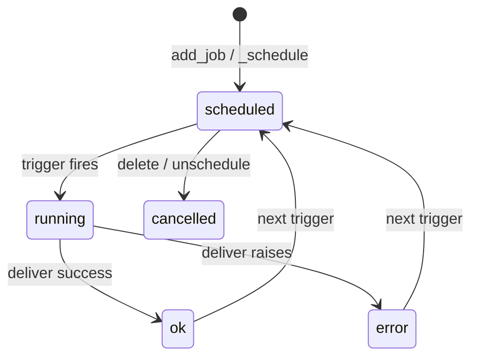

# `Async Job Worker`（单进程 APScheduler / 后台作业组件）

Octop 无外部队列、无独立 worker 进程：所有定时任务由进程级 `CronManager`（`AsyncIOScheduler`）驱动，系统任务（备份/TLS 续期）以非 DB 的 system job 注册，知识索引则用 `asyncio.Semaphore` + `run_in_executor` 并发卸载。

## 1. 后台任务类型全集（Job Registry）

| 任务标识（Kind） | 触发源 | 间隔 / 超时阈值 | 执行主函数（`路径:行号`） | 状态 / 产物落点 |
|---|---|---|---|---|
| `cron:` 用户任务 | `cron_jobs` 行 reload | `misfire_grace_time=60`（`manager.py:251-257`） | `CronJob.run` (`job.py:78`) | `cron_jobs.last_status/last_error` +审计 |
| `interval:` 用户任务 | 同上 | `IntervalTrigger(seconds=int)` (`trigger.py:62-82`) | 同上 | 同上 |
| `date:` 一次性任务 | 同上 | `DateTrigger(fromisoformat)` | 同上 | 同上 |
| `octop_auto_backup` | 启动钩子 `server.py:417-419` | `OCTOP_BACKUP_SCHEDULE` 默认 `cron:0 4 * * *`，`misfire_grace_time=300`（`manager.py:290-308`） | `backup/auto.py:151 run_auto_backup` | `octop-auto-backup-*.tar.gz` + 审计 |
| TLS 自动续期 | `server.py:413-415` | `RENEWAL_WINDOW_DAYS=30`（`tls/renewal.py:19`） | `tls/renewal.py:43 _auto_renew_job` | 证书文件 + TLS 任务状态 |
| 主动关怀循环 | `ProactiveCareScheduler.start_all` (`scheduler.py:177`) | 随机 5–24h，`_MIN_SLEEP_SECONDS=60`（`:314`） | `_run_loop` (`:274`) → `ProactiveCareService.run` (`service.py:83`) | `care_push_records` |
| 知识索引作业 | `resume_pending_index_jobs` (`server.py:455-457`) | `INDEX_CONCURRENCY=2`（`knowledge/jobs.py:17`） | `process_document` (`jobs.py:34`) | `knowledge_documents.status/chunk_count` |

## 2. 执行流与并发控制调用树

```text
OctopServer.start (src/octop/infra/server.py:278)
  └─ _boot_runtime (:353)
       ├─ CronManager.boot (cron/manager.py:75) -> AsyncIOScheduler.start + reload_from_db (:82)
       │    └─ _schedule (:236) -> build_trigger (:62) -> add_job(:251, misfire_grace_time=60)
       ├─ install_auto_renewal_job (tls/renewal.py:74) -> schedule_system_job (:290, grace=300)
       ├─ install_auto_backup_job (backup/auto.py:282) -> schedule_system_job
       ├─ proactive_scheduler.start_all (proactive/scheduler.py:177)
       │    └─ asyncio.create_task(name="proactive_care_{agent_id}") (:245,:274)
       └─ resume_pending_index_jobs (knowledge/jobs.py:82) -> run_in_executor (:63)

CronJob.run (job.py:78)
  ├─ METRICS.inc("cron_runs_total") (:81)
  ├─ CronDeliveryService.deliver (delivery.py:66) [Gateway.run_in_session 锁 :82-86]
  │    ├─ [if text] _deliver_text (:88)
  │    └─ [if agent] _deliver_agent (:131) -> build_harness_request + AgentManager.stream
  ├─ success -> set_run_status("ok") + audit cron.run_ok (:111-116)
  └─ exception -> set_run_status("error") + METRICS cron_errors_total + audit cron.run_failed (:100-110)
```

## 3. 任务状态机与阶段契约



| 状态存储与轮询机制 | 实现细节 | 源码锚点 |
|---|---|---|
| 用户任务状态 | `cron_jobs.last_status/last_error` 持久化，API `GET /api/agents/{aid}/cron` 读取 | `src/octop/infra/db/repos/cron.py`、`src/octop/api/routers/cron.py:75` |
| 系统任务状态 | 内存 `AsyncIOScheduler` job 集合，reload 只删非 system job | `cron/manager.py:68` (`_system_job_ids`)、`:82` |
| 备份互斥 | `BACKUP_LOCK` + `_active_operation`，忙时 `BACKUP_IN_PROGRESS` (409) | `backup/auto.py:42-78` |
| 进程重启影响 | 用户/系统任务从 DB 与启动钩子重建；知识索引把 `processing` 重置为 `pending` 后重排 | `manager.py:75`、`knowledge/jobs.py:82-86` |

## 4. 关键策略常量

| 常量 | 值 | 源码位置 | 影响 |
|---|---|---|---|
| `_PROVIDER_RELOAD_CONCURRENCY` | `6` | `src/octop/infra/agents/manager.py:81` | provider 变更并发重建上限 |
| cron prompt / name | `≤2000` / `≤80` | `cron/task_type.py:7-11` | 创建/更新校验 |
| 备份保留数 | `OCTOP_BACKUP_RETENTION_COUNT=7`（≥1） | `src/octop/config.py:507`、`backup/auto.py:134-135` | `prune_auto_backups` 只删自动备份 |
| 关怀窗口默认 | `09:00–22:00`、`5–24h` | `db/repos/proactive_care_config.py:24-29` | `compute_next_trigger` |
| LLM 探测超时 | `30s` | `providers/probe.py:209-245` | provider test 端点 |

## 5. 共变耦合与修改清单（Co-Change Playbook）

- 新增系统任务：在 `_boot_runtime`（`server.py:353-457`）安装 → 用 `schedule_system_job`（`manager.py:290`）注册，确保 reload 不清除 → 补 `tests/unit/cron/`。
- 修改触发器枚举：`trigger.py:62-82` → `task_type.py` → API 校验与前端表单 → 文档 [业务流](../business/cron-and-proactive.md)。
- **单测隔离铁律**：`tests/conftest.py:54-69` 全局 patch 掉 `ProactiveCareScheduler` 防止多小时 sleep；唯一例外 `tests/unit/proactive/test_scheduler.py`，改调度器必须跑该文件。

## 导航与共变索引

业务语义见 [定时任务与主动关怀](../business/cron-and-proactive.md)，备份失败排查见 [排障 Runbook](../operations/runbook-and-observability.md)，调度器依赖的服务容器见 [数据底座](data-and-adapter.md)。
