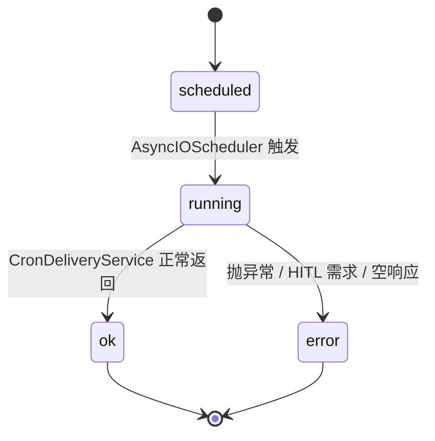

# `async-worker`（定时调度 / 异步后台任务组件）

全仓无外部消息队列：定时任务由进程内 `APScheduler` 守护，知识索引、自动备份、主动关怀、TLS 续期与桌面/移动子进程统一经 `OctopServer._boot_runtime` 装配。任务状态为**内存态**，进程重启后从 `~/.octop/octop.db` 重建调度，但进行中的构建/子进程不恢复。

## 1. 后台任务类型全集（Job Registry）

| 任务标识（Kind） | 触发源 | 间隔 / 超时阈值（配置键） | 执行主函数（路径:行号） | 最终状态/产物落点 |
|---|---|---|---|---|
| `cron.user` | DB `cron_jobs` 行 + APScheduler | `misfire_grace_time=60`（`src/octop/infra/cron/manager.py:256`）；触发器 `interval/cron/date` | `CronJob.run` (`src/octop/infra/cron/job.py:78`) | `cron_jobs.last_status=ok\|error` + 审计 |
| `cron.system` | 系统作业注册 | `misfire_grace_time=300`（`src/octop/infra/cron/manager.py:299`） | `CronManager.schedule_system_job` (`src/octop/infra/cron/manager.py:290`) | 同上 |
| `octop_auto_backup` | `install_auto_backup_job` (`src/octop/infra/backup/auto.py:277`) | `schedule="cron:0 4 * * *"`，`retention>=1`（`src/octop/infra/backup/auto.py:134`） | `run_auto_backup` (`src/octop/infra/backup/auto.py:187`) | `octop-auto-backup-*.tar.gz` + 审计 `backup.auto_ok/failed` |
| `tls.auto-renewal` | `install_auto_renewal_job` (`src/octop/infra/server.py:415`) | ACME 到期驱动 | `infra/setup/tls/` | 证书文件 + `config.json.tls` |
| `proactive-care` | `ProactiveCareScheduler.start_all` (`src/octop/infra/proactive/scheduler.py:177`) | `random.randint(min*60,max*60)`（`:79`），`_MIN_SLEEP_SECONDS=60`（`:314`） | `_run_loop` (`src/octop/infra/proactive/scheduler.py:274`) | 主动消息推送 + `care_push_records` |
| `knowledge-index` | 文档上传/重建 | `INDEX_CONCURRENCY=2`（`src/octop/infra/knowledge/jobs.py:17`） | `process_document` (`src/octop/infra/knowledge/jobs.py:34`) | `knowledge_documents.status=ready\|failed` |
| `pending-index-resume` | 启动期 | — | `resume_pending_index_jobs` (`src/octop/infra/server.py:457`) | 重启后补齐 `pending` 文档 |

## 2. 执行流与并发控制调用树

```text
OctopServer._boot_runtime (src/octop/infra/server.py:353)
  ├─ CronManager(AsyncIOScheduler(timezone=config.default_timezone)) (src/octop/infra/cron/manager.py:65)
  │    ├─ boot() (:75) -> reload_from_db() (:82) -> _schedule (:236)
  │    └─ CronJob.run (src/octop/infra/cron/job.py:78)
  │         ├─ METRICS.inc("cron_runs_total") (:81)
  │         ├─ CronDeliveryService.deliver (src/octop/infra/cron/delivery.py:66) -> run_in_session (:82)
  │         │    ├─ [task_type=="text"] _deliver_text (:88)
  │         │    └─ [else] _deliver_agent (:131) -> agent_manager.stream (:141)
  │         │         ├─ "hitl_required" -> RuntimeError("cron agent run requires user interaction") (:149)
  │         │         └─ 无可见响应 -> RuntimeError("cron agent run produced no visible response") (:153)
  │         ├─ [fail] set_run_status(status="error") (:103) + 审计 "cron.run_failed" (:106)
  │         └─ [ok]   status="ok" (:111) + "cron.run_ok" (:114)
  ├─ install_auto_renewal_job / install_auto_backup_job (src/octop/infra/server.py:415, :419)
  ├─ ProactiveCareScheduler.start_all (:445) -> _run_loop (src/octop/infra/proactive/scheduler.py:274)
  └─ AppRuntime + resume_pending_index_jobs (src/octop/infra/server.py:447, :457)
```

## 3. 任务状态机与阶段契约



| 状态存储与轮询机制 | 代码实现细节 | 源码锚点（路径:行号） |
|---|---|---|
| 触发器解析 | `build_trigger` 仅接受 `interval`（秒）、`cron`（5 字段）、`date`，非法抛 `CRON_TRIGGER_INVALID` | `src/octop/infra/cron/trigger.py:62-82` |
| 任务类型 | `CronTaskType = Literal["text","agent"]`，默认 `"agent"`；prompt ≤2000、name ≤80 字符 | `src/octop/infra/cron/task_type.py:7-10` |
| 运行记录 | `set_run_status(..., status="ok"|"error", last_error)` 写 `cron_jobs` | `src/octop/infra/cron/job.py:103`、`:111` |
| 并发互斥 | 自动备份 `hold_backup_lock("auto")`；配置 `BACKUP_IN_PROGRESS(409)` 拦截重复 | `src/octop/infra/backup/auto.py:193`、`src/octop/infra/errors.py:20` |
| 进程重启影响边界 | 内存态调度清空，`reload_from_db` 重建；pending 索引由 `resume_pending_index_jobs` 续跑 | `src/octop/infra/cron/manager.py:82`、`src/octop/infra/server.py:457` |
| 停机顺序 | `srv.stop()` 依次停 proactive/cron/gateway/agent_registry/user_manager 后 `db.close()` | `src/octop/infra/server.py:489`、`:495-502` |

## 4. 共变耦合与修改清单（Agent Co-Change Playbook）

- **改触发器/状态枚举**：同步 `src/octop/infra/cron/trigger.py:62`、`src/octop/infra/cron/task_type.py:7`、`src/octop/infra/cron/manager.py:256` 与前端 CronJobs 视图（`dashboard/src/pages/Control/CronJobs/`），跑 `uv run pytest tests/unit/cron -q`。
- **改自动备份策略**：核对 `src/octop/config.py:95-103` 默认值、`src/octop/infra/backup/auto.py:134` 的 retention 校验与 [`../contracts/configuration.md`](../contracts/configuration.md) 的 `OCTOP_BACKUP_*` 表。
- **单测隔离铁律**：`tests/conftest.py:54` 的 `_suspend_proactive_care_loops` 自动挂起主动关怀循环；新增无关测试须沿用该 fixture，禁止让守护线程竞争临时目录（见 [`../operations/dev-and-test.md`](../operations/dev-and-test.md)）。
- **排障联动**：`failed`/超时先查 `cron_jobs.last_error` 与审计 `cron.run_failed`，决策树见 [`../operations/runbook-and-observability.md`](../operations/runbook-and-observability.md)。
