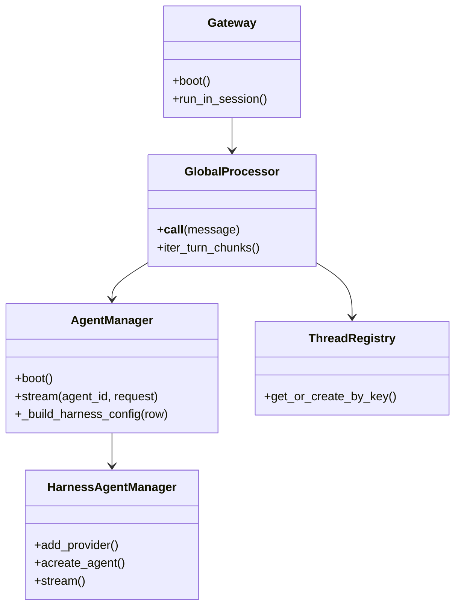

# `Core Engine`（Agent 运行时 + Gateway 消息管线）

核心引擎解决「一个进程内管理多用户多 Agent 运行时，并把 HTTP/IM/CLI/Cron 四种入口归一为同一 harness turn」的问题；对外核心数据结构是 `HarnessAgentConfig` 与 `InboundMessage`，引擎级不变量是单实例归属隔离与图刷新边界。

## 1. 引擎核心不变量（Hard Invariants）

1. **全局单例 + 行级归属隔离**：`AgentManager` 每进程唯一（`server.py:364-370`），agent 归属由 `agents.user_id` 行级判定，admin 可豁免（`src/octop/api/deps.py:217`）；不存在每用户独立 registry。
2. **Bootstrap 图刷新边界不变量**：`is_bootstrapped()` 为假时只挂 `on_bootstrap_complete` 标记（`manager.py:2096-2102`），`_init_graph()` 只能在 stream/call/resume 边界由 `_apply_pending_bootstrap_graph_refresh` 执行（`manager.py:2118`、`:962-994`），中段同步重建会 segfault。
3. **请求字典版本兼容不变量**：`_HARNESS_AGENT_CONFIG_FIELDS=frozenset(fields(HarnessAgentConfig))`（`manager.py:89`），未知键被裁剪，防止上游 harness 版本差异导致构造失败。
4. **工具集门禁不变量**：`CRITICAL_TOOLS={ls,read_file,glob,grep,write_todos,task}` 任何 denylist 都减掉（`tool_catalog.py:10-19`）；`agent_plugin_enabled` 缺省 `True`（`:136-144`），`acp.tool_enabled` 缺省 `False`（`:185-211`）。

## 2. 核心类型层次与职责表



| 核心符号 | 源码锚点 | 持有状态 | 生命周期 |
|---|---|---|---|
| `AgentManager` | `manager.py:321-347` | `_active_invocations`、`_reload_dirty`、`_lock`（`:341-347`） | 进程单例，`boot()` 后活到 `shutdown()` |
| `HarnessAgentManager` | `manager.py:420-426` | providers、team、security policy | 由 `AgentManager.boot` 构造 |
| `Gateway` / `GlobalProcessor` | `gateway.py:199-215` | ChannelManager、WebSocketHub、processor | `await gateway.boot()` 后常驻 |
| `ThreadRegistry` | `threads.py:91-147` | thread 双检锁缓存 | 随 Gateway 生命周期 |
| `WebSocketHub` | `ws/ws_hub.py:26-159` | 连接/线程订阅/`_active_turns` | 进程单例 |

## 3. 核心处理管线与关键阈值

```text
AgentManager.boot (manager.py:417)
  ├─ [policy] ensure_seeded + harness_policy (:418,:425)
  ├─ [providers] build_harness_configs (:419)
  ├─ [factory] HarnessAgentManager(:420-424)
  └─ [rows] list_all(include_disabled=False) -> 仅跳过 last_state=="stopped" (:428-432)
       └─ _start_agent (:2013) -> acreate_agent(:2022) -> _post_start_agent(:2042) -> set_state("running")(:2030)

GlobalProcessor.__call__ (processor.py:517)
  ├─ [resolve] user_id/session_key/metadata (:529-535)
  ├─ [slash] HITL/ask_user/normal 三短路 (:544-637)
  ├─ [thread] get_or_create_by_key (:639)
  ├─ [model] _resolve_harness_model (:423-448) + _resolve_reasoning_overrides (:474)
  ├─ [request] build_harness_request (harness_request.py:255-322)
  └─ [stream] project_stream (:713) + usage/history/completed (:740-747)
```

| 关键常量 / 算法阈值 | 代码值 | 源码位置 | 修改影响 |
|---|---|---|---|
| `_MEMORY_NS_PREFIX` | `"agent_"` | `manager.py:85` | 改内存命名空间会丢历史 memory |
| `_AGENT_STATES_NEEDING_MODEL_RELOAD` | `{"failed","created"}` | `manager.py:87` | provider 变更时决定哪些 agent 重建 |
| `temperature` / `top_p` 范围 | `[0.0,2.0]` / `[0.0,1.0]` | `runtime_limits.py:75-87` | 超限被拒绝 |
| `_DEFAULT_MAX_INPUT_TOKENS` | `128000` | `runtime_limits.py:30` | 写入 `configurable` |
| `_PERSISTED_META_KEYS` 白名单 | 见源码集合 | `message_keys.py:154-173` | 未白名单化的 IM metadata 不落库 |

## 4. 共变耦合与扩展清单（Co-Change Playbook）

- 新增引擎策略：修改 `tool_catalog.py:185-211` 的 `builtin_tool_available` 分派 → `manager.py:2485-2503` 工具求交 → `manager.py:2545-2556` 中间件链 → `tests/unit/agents/`。
- 改模型解析优先级：`processor.py:423-448` → `turn.py:267` 入站校验 → 前端模型选择器 → `tests/unit/gateway/`。
- 改运行时限额：`runtime_limits.py:22-28` 键集合 → `_prepare_stream_request`（`manager.py:2401`）→ `docs/configuration.md` 的用户可见说明。
- **特殊陷阱**：`manager.py:2096-2102` 的 bootstrap 刷新是性能与稳定性的关键折中，改成同步 `_init_graph()` 会在流式回合中 segfault；本仓不实现 harness 引擎本身，详见 [边界声明](../operations/boundary.md)。

## 导航与共变索引

引擎下游配置字典见 [LLM Provider 契约](../integrations/downstream/llm-providers.md)，引擎驱动的对话流程见 [WF-01](../business/chat-turn.md)，工具/MCP 装配见 [Connector 契约](../integrations/downstream/connectors-mcp.md)。
