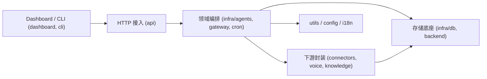

# 仓内模块依赖矩阵与影响面图谱

依赖方向遵循 `AGENTS.md` §5：`dashboard → api → infra → utils/config`，唯一允许同时导入 `infra/server` 与 `api/app` 的是 `launch.py`；`infra/` 禁止反向导入 `api/`、`cli/`。

## 1. 模块依赖拓扑图

## 2. 模块×模块真实调用边明细

| 调用方模块 | 被调方模块 | 耦合介质 | 契约符号 | 证据锚点（`路径:行号`） |
|---|---|---|---|---|
| `cli/run.py` | `launch.py` | 同步函数调用 | `run_foreground_blocking` | `src/octop/cli/commands/run.py:153` → `launch.py:154` |
| `launch.py` | `infra/server.py`、`api/app.py` | 同步函数调用（唯一双导入点） | `OctopServer.start` / `build_app` | `launch.py:74-75`、`:100` |
| `infra/server.py` | `infra/agents/manager.py` | DI 构造 | `AgentManager(...)` | `server.py:364-370` |
| `infra/server.py` | `infra/gateway/gateway.py` | DI 构造 + await boot | `Gateway(...)` | `server.py:381-386` |
| `infra/server.py` | `infra/cron/manager.py` | DI 构造 + await boot | `CronManager(...)` | `server.py:405-411` |
| `gateway/processor.py` | `infra/agents/manager.py` | 同步调用（异步方法） | `AgentManager.stream` | `processor.py:856` → `manager.py:956` |
| `api/routers/*` | `infra/*` services | `Depends(get_server)` + `server.services` | `get_server` | `src/octop/api/deps.py:95` |
| `infra/agents/manager.py` | `infra/connectors/` | MCP 配置组装 | `MCP tool cache / builder` | `manager.py:2586-2601` |
| `infra/cron/delivery.py` | `infra/gateway/gateway.py` | 会话锁 + 推送 | `Gateway.run_in_session` | `cron/delivery.py:82-86` |
| `infra/knowledge/jobs.py` | `infra/db/repos/knowledge.py` | repo 调用 | `resume_pending_documents` | `server.py:455-457` → `repos/knowledge.py:488-502` |
| `infra/backend/adapter.py` | 外部 `harness_agent.backends` | spec 字典 | `resolve_backend` | `backend/adapter.py:44-168`、`resolver.py:79-122` |
| `api/middleware/jwt_auth.py` | `api/deps.py` | 函数调用 | `extract_raw_token` / `resolve_user_from_token` | `jwt_auth.py:37-71` |

## 3. 变更爆炸半径与架构审计

- **高扇入核心底座（改签名必须全仓搜索并跑全量单测）**：
  1. `infra/errors.py:13-104 ErrorCode` / `:202-247 OctopError`——所有 API 错误出口。
  2. `infra/db/services.py:35,93 RepoBundle/SharedServices`——所有 router 与 service 的 repo 注入点。
  3. `infra/agents/manager.py:2649-2678 HarnessAgentConfig` 构造——所有 agent 启动路径。
  4. `infra/utils/paths.py:17 PathLayout.from_env`——启动、备份、CLI、设备桥的路径根。
  5. `api/deps.py:95 get_server`——全部 HTTP handler 的依赖注入。
- **循环依赖与函数内延迟导入（Lazy Import）记录**：
  - `server.py:284`（`ensure_cli_path`）、`:287`（`apply_env_file`）、`:358`（browser idle timeout）、`:372-374`（trajectory）、`:398`（cron delivery）、`:413`（TLS renewal）、`:417`（backup）、`:455`（knowledge jobs）——均写在函数体内规避启动期循环导入。
  - `manager.py:372-374`（trajectory）、`:2586-2601`（MCP）等同理；`launch.py:67-72` 延迟导入 uvicorn/build_app 避免 CLI help 变慢。
- **跨进程 / 外部包边界**：
  - `harness-agent` / `harness-gateway` / `harness-memory`（`pyproject.toml:24-26`）：同进程导入外部包，非内嵌子仓，无 `VENDOR.md` 维护约定；动态插件经 `PluginManager`（`server.py:302-307`）加载 `~/.octop/plugins/*`。
  - `subprocess` 边界：`connectors/gateway/cli_runner.py:61-82`（lark/wecom CLI）、`mobile/adb.py:22-185`、`desktop/input.py:89-108`；固定 argv，禁 `shell=True`。

## 4. 跨仓依赖矩阵（`repo_deps`）

单仓模式，**无跨仓 `repo_deps` 依赖边**。外部依赖均为 PyPI 包与远端服务，其出向字典契约见 [`integrations/index.md`](../integrations/index.md) 与 [`operations/boundary.md`](../operations/boundary.md)；不存在可填 `src_repo/dst_repo` 的仓到仓调用，故不构造占位边。
