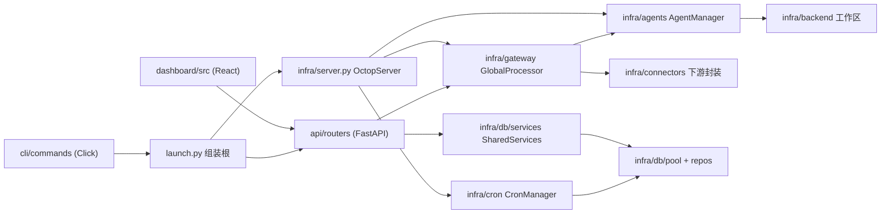

# 仓内模块依赖矩阵与影响面图谱

刻画仓内真实调用边、高扇入底座枢纽与循环/延迟导入边界。依赖方向铁律：`dashboard/ → api/ → infra/ → infra/utils, octop.config`，`cli/ → launch.py → api/ + infra/`；`launch.py` 是唯一允许同时导入 `infra.server` 与 `api.app` 的模块（`AGENTS.md` §5）。

## 1. 模块依赖拓扑图

## 2. 模块 × 模块真实调用边明细

| 调用方模块（Caller） | 被调方模块（Callee） | 耦合介质 | 契约符号 | 证据锚点（路径:行号） |
|---|---|---|---|---|
| `launch.py` | `infra/server.py` | 同步 `await` | `OctopServer.start()` | `src/octop/launch.py:75` |
| `launch.py` | `api/app.py` | 同步工厂调用 | `build_app(srv)` | `src/octop/launch.py:100` |
| `api/app.py` | `infra/errors.py` | 异常处理器注册 | `OctopError` / `ErrorCode` | `src/octop/api/app.py:78`、`:93` |
| `api/app.py` | `api/routers/*` | `_RouterMount` 批量挂载 | `spec.router` | `src/octop/api/app.py:201-266` |
| `api/deps.py` | `infra/db/services.py` | DI 依赖 | `get_server` → `server.services` | `src/octop/api/deps.py:95` |
| `infra/server.py` | `infra/db/services.py` | 启动期装配 | `build_shared_services(...)` | `src/octop/infra/server.py:321` |
| `infra/server.py` | `infra/gateway/gateway.py` | `await boot()` | `Gateway.boot()` | `src/octop/infra/server.py:381-386` |
| `infra/server.py` | `infra/cron/manager.py` | `await boot()` | `CronManager.boot()` | `src/octop/infra/server.py:405-411` |
| `infra/server.py` | `infra/agents/manager.py` | 单例构造 | `AgentManager(...)` | `src/octop/infra/server.py:364` |
| `infra/gateway/process/processor.py` | `infra/agents/manager.py` | 异步生成器 | `agent_manager.stream(...)` | `src/octop/infra/gateway/process/processor.py:856` |
| `infra/gateway/process/processor.py` | `infra/connectors/` | 工具装配 | `_resolve_turn_mcp_servers` | `src/octop/infra/gateway/process/processor.py:661` |
| `infra/cron/delivery.py` | `infra/agents/manager.py` | 异步流 | `agent_manager.stream` | `src/octop/infra/cron/delivery.py:141` |
| `infra/knowledge/jobs.py` | `infra/knowledge/embed.py` | 函数调用 | `embed_knowledge_texts` | `src/octop/infra/knowledge/jobs.py:52` |
| `infra/*` | `infra/metrics.py` | **函数内延迟导入** | `METRICS.inc` | `src/octop/api/routers/admin.py:74` |

## 3. 变更爆炸半径与架构审计（Blast-Radius Audit）

- **高扇入核心底座（改签名必须全仓搜索调用点并跑全量单测）**：
  1. `SharedServices` / `RepoBundle`：23 个 `*_repo` 访问器被全部领域模块依赖（`src/octop/infra/db/services.py:93`、`:103-193`）；新增 repo 须同步 `RepoBundle.from_pool`（`:63`）。
  2. `ErrorCode` / `OctopError`：91 个枚举值贯穿 `infra/` 与 `api/`（`src/octop/infra/errors.py:13`、`:107`）；`to_envelope` 结构变动牵动前端 `apiErrors.*`。
  3. `OctopConfig`：`load_config` 解析结果被 `launch.py`、`server.py`、`api/app.py` 同时消费（`src/octop/config.py:394`、`:555`）。
  4. `SqlitePool.connect` / `transaction`：所有 23 个 repo 共用（`src/octop/infra/db/pool.py:54`、`:59`）。
- **循环依赖与函数内延迟导入（Lazy Import）记录**：`METRICS` 按仓库约定在热路径函数体内部导入以规避循环引用，典型位置 `src/octop/api/routers/admin.py:74`（`from octop.infra.metrics import METRICS`）；`src/octop/infra/agents/metrics.py` 同样建议懒加载。`src/octop/api/app.py:121`、`:135`、`:144` 为延迟导入（CORS 依赖、TLS challenge store、router 集合），属启动期规避装配顺序，非循环依赖。
- **硬依赖禁令（违反即架构门禁失败）**：`infra/` → `api/|cli/|launch.py`；`api/` → `cli/|launch.py`；`cli/` → `api/`；`infra/db/repos/` → 非 DB `infra` 包；`infra/utils/` → 非 utils `infra` 包（`AGENTS.md:97-104`）。
- **内嵌子仓 / 跨进程边界**：`harness-agent` / `harness-gateway` / `harness-memory` / `harness-browser` 以 wheel 依赖经同进程 import 注入（`pyproject.toml:13-48`），本仓只持有配置与调用封装，不含其源码；ACP runner、CLI runner、Feishu bot creator 经 `subprocess` 跨进程桥接，见 [`../overview/callchain-panorama.md`](../overview/callchain-panorama.md)。

## 4. 跨仓依赖矩阵（`repo_deps`）

> 单仓工作区模式：工作区仅纳管 `repo/` 一个仓库，无仓到仓 `repo_deps` 边，禁止填写任何无源码证据的占位边。仓库外部下游依赖（LLM Provider、MCP/SaaS、IM 平台、OIDC、对象存储）统一登记于 [`../integrations/index.md`](../integrations/index.md)，并逐系统展开字典契约。跨仓环检测结论：**不适用（单仓模式）**。

## 5. 共变耦合与修改清单（Co-Change Playbook）

1. 改 `SharedServices` 成员：同步 `src/octop/infra/db/services.py:35` 与 `:93` 定义 → 全仓 grep `server.services.` 调用点 → 跑 `uv run pytest tests/unit/db -q`。
2. 改 `ErrorCode`：同步 [`../contracts/error-codes.md`](../contracts/error-codes.md) 全表与前后端 i18n 键，运行 `uv run pytest tests/unit/i18n -q`。
3. 新增 `infra/` 子包：核对 `AGENTS.md:97-104` 依赖方向，必要时在 [`../operations/pitfalls-and-adr.md`](../operations/pitfalls-and-adr.md) 登记隐式耦合。
