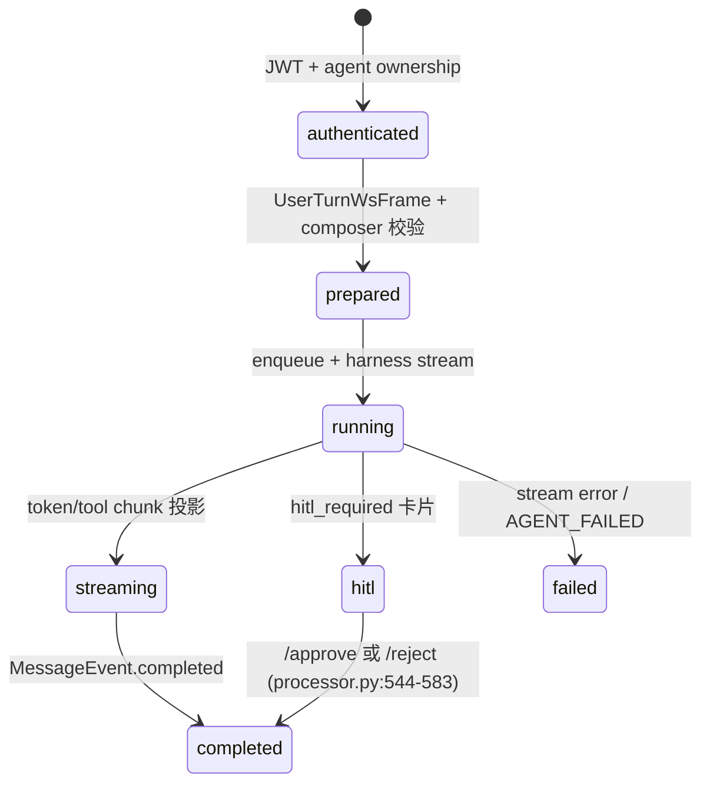

# `WF-01 · 对话回合（Dashboard / IM / CLI 统一 Harness Turn）`

三类入口（Dashboard WebSocket、IM 渠道、CLI REPL）最终都归一为 `InboundMessage`，经 `GlobalProcessor` 构造 harness 请求并流式投影回各出口；本页以 Dashboard 链为主干，标注 IM 差异。

## 1. 符号级端到端执行调用树

```text
WS /api/agents/{aid}/chat/ws -> src/octop/api/routers/chat/ws.py:32 dashboard_chat_ws(req)
  ├─ [guard: JWT + agent 归属] ws.py:47-63 resolve_user_from_token / assert_agent_access
  │    └─ denied -> WS close 4001(鉴权) / 4003(权限) / 4404(无此 agent) / 1011(未就绪)
  ├─ [frame: 入站分派] ws.py:90-130 ping / subscribe / cancel / user_turn
  │    ├─ cancel -> src/octop/infra/agents/manager.py:cancel_stream
  │    └─ user_turn -> ws.py:135 UserTurnWsFrame 校验（空内容 ws.py:142 拒绝）
  ├─ [prepare: 参数与归属] src/octop/api/routers/chat/turn.py:226 prepare_dashboard_turn
  │    ├─ turn.py:245 prepare_chat_mcp（校验失败）
  │    ├─ turn.py:267 校验 model ref
  │    └─ turn.py:283-285 update_composer + build_composer_context
  ├─ [inbound: 元数据注入] turn.py:306-349 build_dashboard_inbound
  │    └─ keys: ws_connection_id/session_key/thread_id/user_is_admin/mcp_servers(含[])/knowledge_base_ids(含[])/skills/model/reasoning_mode/reasoning_effort/octop_composer_context/octop_inbound_attachments/target_agent_ids
  ├─ [dispatch] ws.py:167 hub.subscribe + :168 channel_manager.enqueue(WS_CHANNEL_ID, inbound)
  │    └─ src/octop/infra/gateway/ws/ws_channel.py:90 WebSocketChannel.handle_inbound
  ├─ [orchestrate] src/octop/infra/gateway/process/processor.py:517 GlobalProcessor.__call__
  │    ├─ :529 resolve_user_id_for_message / :533 session_key_from_message / :535 sanitize_im_metadata
  │    ├─ :537 parse_slash -> :544-583 HITL approve/reject/pending | :587-618 ask_user_question 应答 | :620-637 普通 slash
  │    ├─ :639 ThreadRegistry.get_or_create_by_key -> thread_id
  │    ├─ :649 build_content_from_message / :654 _resolve_harness_model / :661 _resolve_turn_mcp_servers
  │    ├─ :686 build_harness_request -> src/octop/infra/gateway/process/harness_request.py:255
  │    ├─ :713 project_stream -> src/octop/infra/gateway/process/stream_project.py:110 _project_chunks
  │    └─ :740 _record_turn_usage / :746 _record_turn_history / :747 MessageEvent.completed
  └─ [engine] src/octop/infra/agents/manager.py:956 stream -> :964 _harness_manager.stream
       ├─ :949 _track_invocation（并发去重）
       └─ :2401 _prepare_stream_request（补 agent_id、plugin_tool_configs、runtime limits）
```

## 2. 分阶段业务规则与分支判定表

| 阶段 | 负责函数（`路径:行号`） | 精确布尔条件 / 阈值 | 命中分支行为 | 副作用 |
|---|---|---|---|---|
| WS 鉴权 | `ws.py:47-63` | token 缺失 / agent 不属于调用者 | close 4001 / 4003 / 4404 / 1011 | 不建会话 |
| 入站校验 | `ws.py:135-142` | `UserTurnWsFrame` 校验失败或内容为空 | 短路，不发 `user_turn` | 无 |
| 模型解析 | `processor.py:423-448` | `meta["model"]` → `sticky_model` → `thread_model` → `resolve_explicit_default_model` → 用户偏好 → `resolve_fallback_model_ref` → None | 失效 ref 在 :448 丢弃，AUTO 交 harness | 更新 thread.model_ref |
| 推理覆盖 | `processor.py:474`、`reasoning.py:160-227` | meta → thread → 用户偏好 | 生成 `octop_reasoning_overrides` 字典 | 落入 `configurable` |
| 视觉降级 | `harness_request.py:96-164` | 图片数 > `VISION_MAX_COUNT` | 前 N 张转 image_url，其余降级为路径提示 | 内容块数组 |
| 组群上下文 | `message_keys.py:16-43` | `model != default` 才写 `model` 键 | `connectors/skills/targetAgents/model` 拼入 composer context | Inbound metadata |
| 用户归属 | `message_keys.py:67-93` | dashboard/CLI 用数字 `user.id`；外部 IM 一律归 agent owner，兜底 0 | 决定 `session_key` 与 usage 记账主体 | session_key |
| 流式投影 | `stream_project.py:110-229` | `token/reasoning/tool_call_chunk/tool_result/hitl_required` | 映射为 `delta/thinking_delta/tool_start/tool_end`/卡片并 `return` | WS 出站帧 + 媒体去重 |
| Trajectory | `trajectory/settings.py:16-31` | `enable_trajectory` 仅显式 `false` 关闭 | 采集 `user/assistant/tool/context/system` 事件 | `trajectory_events` 表；阈值 64000 字符 / 240 摘要 / 50 轮保留 / SSE 回放 2000 |
| 断连恢复 | `ws.py:180-184` | 连接断开 | 仅 `unregister`，不取消在途 turn | weak resume，重连后按 thread 订阅回放 |

## 3. 实体状态机与合法迁移约束



不可违反的不变量：agent 归属必须在 `ws.py:47-63` 与 `_assert_agent_owner` 双重校验；同一 thread 的 `session_key` 由 `threads.py:21-30 make_key` 唯一决定，禁止调用方自造；usage/trajectory 必须在 `completed` 前落账（`processor.py:740-747`）。

## 4. 幂等、并发互斥与异常补偿

| 边界场景 | 检测条件（`路径:行号`） | 保护 / 回滚动作 |
|---|---|---|
| 同 agent 并发重复 turn | `manager.py:949 _track_invocation`、`manager.py:341-347 _active_invocations` | 在途计数与 busy 判定，返回 `AGENT_BUSY` |
| WS 断线重连 | `ws.py:180-184` finally 仅 unregister | 在途 turn 继续跑；重连按 `subscribe` 重新绑定 thread |
| agent 未 bootstrap | `manager.py:2096-2102` `agent.is_bootstrapped()` 为假 | 挂 `on_bootstrap_complete` 标记，在 stream/call/resume 边界刷新图（`:962-994`），禁止同步 `_init_graph()` |
| 知识检索异常 | `src/octop/infra/knowledge/retrieve.py:22-132` | 吞异常返回空串，turn 继续（降级不报错） |
| 媒体工具结果重复 | `stream_project.py:110-229 emitted_media_ids` | 去重后才发媒体事件 |
| SSE 序列化失败 | `src/octop/api/routers/chat/sse.py:24-32` | 回退帧 `{"type":"error"}`，防半帧截断 |

## 5. 共变耦合与修改清单（Co-Change Playbook）

1. 新增入站字段：`turn.py:306-349 build_dashboard_inbound` 写 metadata → `message_keys.py:16-43 build_composer_context` 映射 → `harness_request.py:255-322` 请求字典 → 对应 [下游契约](../integrations/downstream/llm-providers.md)。
2. 新增出站事件：`stream_project.py:110-229` 分派 → `ws.py` 帧模型 → 前端 `dashboard/src/utils/parseHarnessChunk.ts` → [接口参考](../contracts/api-reference.md)。
3. 必跑回归：`uv run pytest tests/unit/gateway -q`、`uv run pytest tests/integration -x -q`（详见 [构建与单测](../operations/dev-and-test.md)）。
