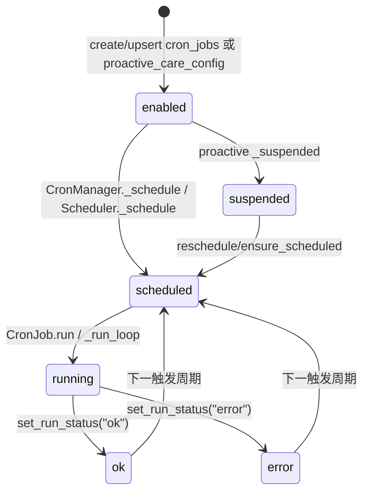

# `WF-02 · 定时任务与主动关怀（APScheduler 单进程调度）`

两条后台自动化链共享 `Gateway` 推送出口：Cron 由 `cron_jobs` 行驱动，主动关怀由 `proactive_care_config` 行驱动；无外部队列、无独立 worker，全部在单进程 `asyncio` 中调度。

## 1. 符号级端到端执行调用树

```text
OctopServer._boot_runtime -> src/octop/infra/server.py:405-419 CronManager + install_auto_renewal_job + install_auto_backup_job
  └─ CronManager.boot -> manager.py:75 start() + reload_from_db()
       ├─ [create] manager.py:105 create(spec) -> :108 build_trigger 校验 -> :109-112 session_key = spec.session_key or ThreadRegistry.dashboard_key(...)
       ├─ [schedule] manager.py:236 _schedule -> :241-247 build_trigger 失败仅 warning 跳过 -> :251-257 add_job(misfire_grace_time=60)
       └─ [fire] job.py:78 CronJob.run
            ├─ :81 METRICS.inc("cron_runs_total")
            ├─ :85 CronDeliveryService.deliver
            │    ├─ delivery.py:82-86 Gateway.run_in_session 锁内执行；fresh_thread 先 reset_by_session_key
            │    ├─ :77 _deliver_text（写规范消息 id cron:{delivery_id}:human/assistant）
            │    └─ :80 _deliver_agent -> :131 build_harness_request + AgentManager.stream -> :144 收集 token/delta
            │         ├─ :146-149 hitl_required -> RuntimeError
            │         ├─ :151-153 空输出 -> RuntimeError
            │         └─ :155-163 usage(source="cron") + 投影/通知 best-effort
            ├─ 异常 -> :100-110 cron_errors_total + set_run_status(error) + 审计 cron.run_failed
            └─ 成功 -> :111-116 status="ok" + 审计 cron.run_ok

ProactiveCareScheduler.start_all -> scheduler.py:177
  └─ _run_loop (:274)
       ├─ :282-287 cfg.enabled==False -> return（退出循环）
       ├─ :314 _MIN_SLEEP_SECONDS=60 防忙等，:326-333 等待后再次校验 enabled
       ├─ :335-347 非活跃时段 continue
       ├─ :350 list_by_agent(limit=10)，:358-362 优先有 channel_id 的 IM session
       └─ :365-373 ProactiveCareService.run 异常仅记日志
            └─ service.py:83 -> :143-150 list_episodes(after=now-30d, limit=200) -> picker._score -> :236 LLM(timeout=30s, 截断200字) -> :250-274 先 push 后写去重
```

## 2. 分阶段业务规则与精确阈值

| 阶段 | 函数（`路径:行号`） | 精确条件 / 阈值 | 命中行为 | 状态副作用 |
|---|---|---|---|---|
| 触发器解析 | `trigger.py:62-82` | `interval:`→`IntervalTrigger(seconds=int)`；`cron:`→严格 5 字段；`date:`→`fromisoformat`；未知/空/解析失败 | `OctopError(CRON_TRIGGER_INVALID)` (400) | 不创建任务 |
| 星期归一 | `trigger.py:15-53` | 数字转 `sun..sat`（含 7）；`0<=first,last<=7`、`first>last`、`step<=0` 均报错 | 拒绝非法 crontab | — |
| 任务类型 | `task_type.py:7-11` | `Literal["text","agent"]`，默认 `agent`；prompt ≤ 2000、name ≤ 80 | 未知值回落 agent；超限 `ValueError` | — |
| 工具创建差异 | `tools.py:94-145` | 6 个 tool：`cronjob_list/get/create/update/delete/run_now`；仅专家 owner 可管；create 默认 `task_type="text"` | 与 manager 默认 `agent` 不同 | `cron_jobs` 行 |
| session 归属 | `manager.py:263-277` | session 的 agent/user 不符 → `ValueError`；`split(":",3)` 取 `channel_type=parts[1]`、`chat_type=parts[3]` | 拒绝跨 agent 复用 | — |
| 系统任务重排 | `manager.py:290-308` | 系统 job（自动备份/TLS 续期）不入 DB，`misfire_grace_time=300`，reload 不清除 | 重启后自动恢复 | cron manager 内存 |
| 关怀时间窗 | `scheduler.py:44-108` | 随机 `randint(min*60, max*60)` 分钟；落在 `[start,end)` 直接返回；越界→下窗 start + `randint(0,120)` 分钟，当日已过则次日 | 调度下一轮 | 配置默认 09:00-22:00、5-24h（`repos/proactive_care_config.py:24-29`） |
| 关怀候选打分 | `picker.py:30-65`、`:68` | `intensity × emotion_weight × recency_weight`；负向情绪 sad/angry/anxious/frustrated=1.5，tired/reflective=1.2，其它=1.0；`<1d=1.0 / <3d=0.8 / else 0.6` | 7 天无候选扩至 30 天（`:128-150`），按人去重，top_k=3 | 推送去重记录 |
| 关怀内容门禁 | `service.py:132-161` | 无 memory / 无 episode 直接 return；LLM timeout=30s；文本截断 200 字 | 不推送 | `care_push_records` |
| 自动备份并发 | `backup/auto.py:42-78` | `BACKUP_LOCK` + `_active_operation`，忙时 `BACKUP_IN_PROGRESS` | 拒绝并发备份 | 审计 `backup.auto_ok/auto_failed` |

## 3. 状态机与持久化



`cron_jobs` 关键字段见 `src/octop/infra/db/migrations/001_initial.sql:96-113`：`schedule_spec/prompt/session_key/fresh_thread/task_type CHECK IN('text','agent')/last_run_at/last_status/last_error`；关怀配置见 `src/octop/infra/db/repos/proactive_care_config.py:24-29`。进程重启后 Cron 从 DB 重建（`manager.py:75-82`），关怀从 `list_enabled()` 重建（`scheduler.py:177`），均无磁盘任务队列。

## 4. 幂等、并发与异常补偿

| 边界场景 | 检测条件（`路径:行号`） | 保护 / 回滚 |
|---|---|---|
| 高频更新任务 | `manager.py:2337 _reload_worker` + `_reload_dirty` 集合 | 合并脏任务，避免重复 rebuild |
| `run-now` 立即执行 | `manager.py:220` `asyncio.ensure_future(job.run())` | 与定时触发共享 `Gateway.run_in_session` 锁 |
| fresh_thread 重入 | `delivery.py:70-71` `reset_by_session_key` | 先重置会话再推送，防旧上下文污染 |
| 任务异常中断 | `job.py:100-110` | 记录 `cron_errors_total`，写 `last_status=error`，不重试无限循环 |
| 关怀任务崩溃 | `scheduler.py:265-272` | 仅记 error，**不自动重建 task**，需下次配置变更触发 reschedule |
| 忙等防护 | `scheduler.py:314` `_MIN_SLEEP_SECONDS=60` | 等待后再次校验 enabled（`:326-333`） |

## 5. 共变耦合与修改清单（Co-Change Playbook）

1. 新增触发器类型：`trigger.py:62-82` 枚举 → `cron.py` API 校验 → `tests/unit/cron/` → 文档 [配置手册](../contracts/configuration.md) 的 `OCTOP_BACKUP_SCHEDULE` 默认值。
2. 修改关怀窗口/打分：`scheduler.py:44-108` + `picker.py:30-65` + `repos/proactive_care_config.py:24-29` 默认值 + `tests/unit/proactive/test_scheduler.py`（该文件是唯一不被全局 fixture 静默的用例）。
3. **必跑回归**：`uv run pytest tests/unit/cron tests/unit/proactive -q`；改动调度器时注意 `tests/conftest.py:54-69` 会全局 patch `ProactiveCareScheduler`。

## 导航与共变索引

调度器实现见 [异步任务组件](../architecture/async-job-worker.md)，配置键见 [配置手册](../contracts/configuration.md)，模型连通性见 [Provider 契约](../integrations/downstream/llm-providers.md)。
