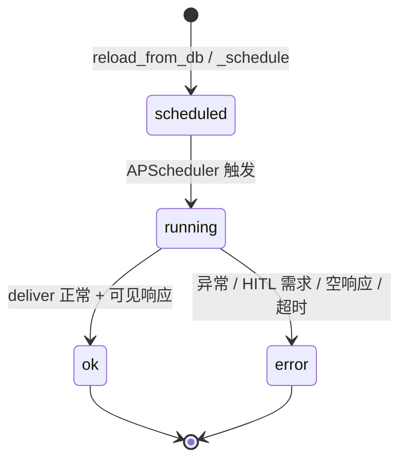

# `WF-03` · 定时任务与主动推送

定时任务由进程内 `APScheduler` 驱动，投递时按 `task_type` 分「直发文本」与「走 Agent 流」两路；主动关怀与自动备份是系统级常驻作业。全链路状态写 `cron_jobs.last_status` 与 `audit_log`。

## 1. 符号级端到端执行调用树

```text
Trigger: AsyncIOScheduler (src/octop/infra/cron/manager.py:65, timezone=config.default_timezone)
  -> CronManager._schedule (src/octop/infra/cron/manager.py:236, misfire_grace_time=60, :256)
  -> CronJob.run (src/octop/infra/cron/job.py:78)
  ├─ [metric] :81 METRICS.inc("cron_runs_total")
  ├─ [deliver] CronDeliveryService.deliver (src/octop/infra/cron/delivery.py:66) -> run_in_session (:82)
  │    ├─ [task_type=="text"] _deliver_text (:88)
  │    └─ [else] _deliver_agent (:131) -> agent_manager.stream (:141)
  │         ├─ "hitl_required" -> RuntimeError("cron agent run requires user interaction") (:149)
  │         └─ 无可见响应 -> RuntimeError("cron agent run produced no visible response") (:153)
  ├─ [fail] set_run_status(status="error", ...) (:103) + 审计 "cron.run_failed" (:106)
  └─ [ok]   status="ok" (:111) + "cron.run_ok" (:114) + record_turn_usage(source="cron") (:162)
```

## 2. 分阶段业务规则与分支判定表（Exact Code Rules & Thresholds）

| 阶段 | 负责函数（路径:行号） | 精确布尔条件 / 阈值常量 | 命中分支行为 | 状态副作用 |
|---|---|---|---|---|
| 触发器解析 | `build_trigger` (`src/octop/infra/cron/trigger.py:62`) | `"interval"` → `IntervalTrigger(seconds=int(value))`（`:71`）；`"cron"` → 5 字段（`:53-59`，weekday 0-7，`:38-39`）；`"date"` → `DateTrigger`（`:75`） | 非法 → `CRON_TRIGGER_INVALID(400)`（`:65`、`:78`、`:82`） | 不调度 |
| 任务类型 | `CronTaskType` (`src/octop/infra/cron/task_type.py:7-8`) | `Literal["text","agent"]`，默认 `"agent"` | text 直发 / agent 走流 | `cron_jobs.task_type` |
| 名称/提示词长度 | `src/octop/infra/cron/task_type.py:9-10` | `CRON_PROMPT_MAX_LEN=2000`、`CRON_NAME_MAX_LEN=80` | 超限拒绝 | 无 |
| 调度容差 | `CronManager._schedule` (`src/octop/infra/cron/manager.py:256`) | `misfire_grace_time=60`；系统作业 `:299` 为 `300` | 超时窗内补跑 | 无 |
| 主动关怀间隔 | `compute_next_trigger` (`src/octop/infra/proactive/scheduler.py:44`) | `random.randint(min*60, max*60)`（`:79-82`）、`random.randint(0,120)`（`:94`）、`_MIN_SLEEP_SECONDS=60`（`:314`） | 随机化下次触发 | `care_push_records` |
| 自动备份 | `run_auto_backup` (`src/octop/infra/backup/auto.py:187`) | `hold_backup_lock("auto")`（`:193`）；`retention >= 1`（`:134`）；`AUTO_BACKUP_JOB_ID="octop_auto_backup"`（`:36`） | 重复触发被 `BACKUP_IN_PROGRESS(409)` 拦截 | 归档文件 + 审计 |
| 备份包含项 | `BackupConfig` (`src/octop/config.py:98-103`) | `include_config/workspaces/skill_packages/plugins/knowledge=True`，`include_chats=False` | 按开关裁剪归档 | 无 |

## 3. 实体状态机与合法迁移约束



- **不可违反的业务不变量**：`CronJob.run` 无论成功失败都必须写 `last_status`（`src/octop/infra/cron/job.py:103`、`:111`）并落审计；`hitl_required` 在 cron 场景**必须失败**，不能挂起等待人工（`src/octop/infra/cron/delivery.py:149`）。

## 4. 幂等、并发互斥与异常补偿回滚表

| 边界 / 故障场景 | 源码检测条件 | 保护/回滚/降级动作 |
|---|---|---|
| 自动备份并发触发 | `hold_backup_lock("auto")` (`src/octop/infra/backup/auto.py:193`) | 拦截为 `BACKUP_IN_PROGRESS(409)`（`src/octop/infra/errors.py:20`） |
| 任务抛异常 | `src/octop/infra/cron/job.py:103` | `status="error"` + `cron.run_failed` 审计，不重试无限循环 |
| Agent 流无可见文本 | `src/octop/infra/cron/delivery.py:153` | `RuntimeError("cron agent run produced no visible response")` → 记 error |
| 进程重启 | `CronManager.reload_from_db` (`src/octop/infra/cron/manager.py:82`) | 内存调度清空后按 DB 重建；进行中不恢复 |
| 停机 | `src/octop/infra/server.py:495-499` | 依次停 proactive/cron/gateway/agent_registry/user_manager |

## 5. 共变耦合与修改清单（Agent Co-Change Playbook）

1. 改触发器/任务类型：同步 `src/octop/infra/cron/trigger.py:62`、`src/octop/infra/cron/task_type.py:7`、`src/octop/infra/cron/manager.py:256` 与前端 `dashboard/src/pages/Control/CronJobs/`（[`../architecture/dashboard-ui.md`](../architecture/dashboard-ui.md)）。
2. 改状态/审计字面量：同步 [`../overview/glossary.md`](../overview/glossary.md)、[`../contracts/error-codes.md`](../contracts/error-codes.md) 与 [`../operations/runbook-and-observability.md`](../operations/runbook-and-observability.md) 的 `cron.run_*` 决策树。
3. 改自动备份策略：核对 [`../contracts/configuration.md`](../contracts/configuration.md) 的 `OCTOP_BACKUP_*` 与 `src/octop/config.py:95-103` 默认值。
4. 必跑回归：`uv run pytest tests/unit/cron tests/unit/proactive tests/unit/backup -q`；新增无关测试须沿用 `tests/conftest.py:54` 的守护线程挂起 fixture。
