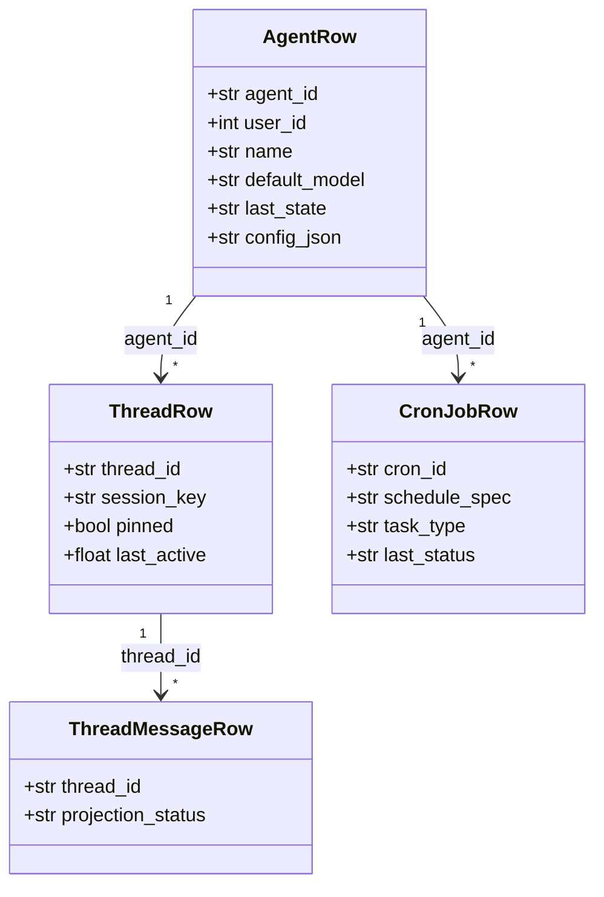

# `Agent` / `Thread` / `CronJob` 聚合实体

三个实体构成「谁在什么会话里、按什么调度执行」的主轴：`AgentRow` 由 `AgentManager` 驱动状态机，`ThreadRow` 由 `ThreadRegistry` 按确定性键聚合，`CronJobRow` 由 `CronManager` 调度。全部行实体为 `@dataclass(frozen=True)`，禁止裸改字段。

## 1. 实体与存储关系图

## 2. 精确字段字典（Exact Schema Dictionary）

| 字段 / JSON 键路径 | 类型 | 必填 / 默认值 | 枚举值集合与业务约束 | 定义/校验源码锚点（路径:行号） |
|---|---|---|---|---|
| `AgentRow.agent_id` | `str` | 必填，公开 UNIQUE | 字符串 ID，禁止用整数 `id` 做外键 | `src/octop/infra/db/repos/agents.py:23`、`src/octop/infra/db/migrations/001_initial.sql:30` |
| `AgentRow.name` | `str` | 必填 | `UNIQUE(user_id, name)`；冲突 → `AGENT_NAME_TAKEN(409)` | `src/octop/infra/db/migrations/001_initial.sql:48`、`src/octop/infra/errors.py:37` |
| `AgentRow.enabled` | `int` | `1` | 启停开关 | `src/octop/infra/db/migrations/001_initial.sql:30` |
| `AgentRow.last_state` | `str` | — | `starting|running|stopped|failed|created` | `src/octop/infra/agents/manager.py:87`、`:573`、`:711`、`:2030` |
| `AgentRow.config_json` | `str` | `"{}"` | 含 `memory` 段等扩展配置 | `src/octop/api/routers/memory.py` |
| `ThreadRow.thread_id` | `str` | 必填，UNIQUE | `f"thr_{new_ulid()}"` | `src/octop/infra/gateway/threads.py:389`、`src/octop/infra/db/repos/threads.py:55` |
| `session_key` | `str` | 必填，UNIQUE | 网关会话定位键，可 `rebind` | `src/octop/infra/db/repos/sessions.py:111`、`src/octop/infra/gateway/threads.py:188` |
| `ThreadMessageRow.projection_status` | `str` | — | `ready|pending|queued|running|failed` | `src/octop/infra/db/repos/thread_messages.py:21`、`src/octop/infra/db/migrate.py:891`、`:926` |
| `CronJobRow.cron_id` | `str` | 必填，UNIQUE | 调度作业公开 ID | `src/octop/infra/db/repos/cron.py:65`、`src/octop/infra/db/migrations/001_initial.sql:96` |
| `CronJobRow.schedule_spec` | `str` | 必填 | 由 `build_trigger` 解析为 `interval`/`cron`/`date` | `src/octop/infra/cron/trigger.py:62` |
| `CronJobRow.task_type` | `str` | `"agent"` | `CHECK(task_type IN ('text','agent'))` | `src/octop/infra/db/migrations/001_initial.sql:106`、`src/octop/infra/cron/task_type.py:7-8` |
| `CronJobRow.last_status` | `str` | — | `ok|error` | `src/octop/infra/cron/job.py:103`、`:111` |
| 线程键 | `str` | — | `f"{agent_id}:{channel_type}:{channel_subject_id}:{channel_chat_type}"` | `src/octop/infra/gateway/threads.py:30` |
| 通道/会话字面量 | `str` | — | `dashboard|cli`、`dm|group` | `src/octop/infra/gateway/threads.py:16-19` |

## 3. 全库存储介质与读写归属矩阵（Writer / Reader Ownership）

| 存储载体 | 权威写入方（Writers + 路径:行号） | 读取消费方（Readers + 路径:行号） | 并发与原子性机制 |
|---|---|---|---|
| `agents` | `AgentRepo.create/set_state`（`src/octop/infra/db/repos/agents.py:81`） | `AgentManager._start_agent`（`src/octop/infra/agents/manager.py:2013`）、`src/octop/api/routers/agents.py:298` | 参数化 SQL + `SharedServices` 事务 |
| `threads` | `ThreadRepo.insert/touch_last_active`（`src/octop/infra/db/repos/threads.py:155`） | `src/octop/api/routers/chat/history.py:87`、`src/octop/api/routers/chat/serialize.py:881` | `session_key` UNIQUE + `rebind` |
| `thread_messages` | `ThreadMessageRepo.append_if_ready/replace_all`（`src/octop/infra/db/repos/thread_messages.py:57`） | `src/octop/api/routers/chat/history.py:260`、`trajectory` 投影 | 投影状态机 |
| `sessions` | `SessionRepo.upsert/set_thread`（`src/octop/infra/db/repos/sessions.py:111`） | `ThreadRegistry.get_or_create`（`src/octop/infra/gateway/threads.py:91`） | 单会话单行 |
| `cron_jobs` | `CronJobRepo.create/set_run_status`（`src/octop/infra/db/repos/cron.py:129`） | `CronManager.reload_from_db`（`src/octop/infra/cron/manager.py:82`） | `misfire_grace_time=60` |
| `audit_log` | `AuditRepo.write`（`src/octop/infra/db/repos/audit.py:39`） | `src/octop/api/routers/admin.py:47` | 追加日志 |

## 4. 共变耦合与修改清单（Co-Change Playbook）

- 改 `last_state` / `projection_status` / `task_type` 枚举：同步 [`../../overview/glossary.md`](../../overview/glossary.md) 字面量集合、[`../message-processing.md`](../message-processing.md) 状态机、[`../cron-automation.md`](../cron-automation.md) 分支表与前端进度展示（`dashboard/src/pages/Chat/hooks/turnStatusGate.ts`）。
- 改线程键格式：必须同步 `src/octop/infra/gateway/threads.py:30` 与所有历史数据迁移，否则旧会话全部错位。
- 新增字段：成对 `.sql` + `.pg.sql` 迁移 → `migrate.py` helper 幂等 → `ThreadRow`/`AgentRow` dataclass → repo 序列化 → 单测 fixture（见 [`index.md`](index.md) 第 4 节）。
- 必跑回归：`uv run pytest tests/unit/db tests/unit/gateway tests/unit/cron -q`。
