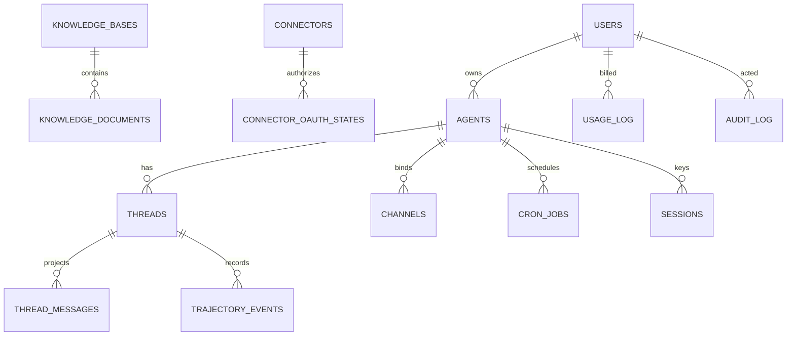

# 核心领域与数据模型总览

控制面数据统一落在 SQLite（WAL）或 PostgreSQL，同一 schema 双引擎迁移；harness checkpoints 与 memory DDL 分属外部库，本页只记录本仓权威写入的表与字段。

## 1. 实体与存储关系图

## 2. 精确字段字典（节选核心表）

> 字段名/约束取自 `001_initial.sql` 及后续迁移；完整清单见 `src/octop/infra/db/migrations/`（001–013，每版 `.sql` + `.pg.sql` 双文件）。

| 表 / 字段 | 类型 | 必填 / 默认值 | 约束与业务语义 | 定义锚点 |
|---|---|---|---|---|
| `users.user_id` | `INTEGER` | PK AUTOINCREMENT | 登录身份为 `username`，整数 FK 用于所有用户关联表 | `001_initial.sql:16-28` |
| `agents.id` / `agents.agent_id` | `INTEGER` / `TEXT UNIQUE` | 双主键 | 整数 pk 仅内部；公开 `agent_id`（ULID/短 ID）用于 API 路径与子表 FK | `001_initial.sql:30-47`、`007_resource_identity_and_profile.sql` |
| `providers.name` / `voice_providers.name` | `TEXT PK` | 必填 | name-keyed 配置，不走公开字符串 ID 规则 | `001_initial.sql:52-78` |
| `cron_jobs.schedule_spec` | `TEXT` | 必填 | `interval:<秒>` / `cron:<5 字段>` / `date:<ISO>` | `001_initial.sql:96-113` |
| `cron_jobs.task_type` | `TEXT` | `'agent'` | `CHECK IN('text','agent')`，与 `task_type.py:7-11` 呼应 | `001_initial.sql:96-113` |
| `cron_jobs.last_status/last_error` | `TEXT` | — | `set_run_status` 写入，排障入口 | `src/octop/infra/db/repos/cron.py` |
| `sessions.session_key` | `TEXT UNIQUE` | 必填 | `agent:channel:subject:chat_type`（`threads.py:21-30`） | `001_initial.sql:115-129` |
| `threads.thread_id` | `TEXT UNIQUE` | `thr_<ULID>` | 公开会话 ID，与来源无关；`threads.py:388` 生成 | `001_initial.sql:133-144` |
| `connectors` / `connector_oauth_states` | `TEXT` | — | 凭证加密存储，OAuth state 一次性消费 | `001_initial.sql:150-177`、`013_connector_instances.sql` |
| `usage_log` / `audit_log` | append-only | — | 计数器与审计，PK 整数，不套资源表规则 | `001_initial.sql:181-238` |
| `settings` / `secrets` | KV | — | `settings.get_active_model`、`secrets.get_or_create("jwt")` | `001_initial.sql:198-229` |
| `proactive_care_config` | 1:1 by `agent_id` | 默认 `enabled=True,09:00-22:00,5-24h` | `src/octop/infra/db/repos/proactive_care_config.py:24-29` | `001_initial.sql:246-254` |
| `trajectory_events` | `event_id/thread_id/seq/kind/turn_id/...` | `UNIQUE(thread_id,seq)` | SSE 回放按 seq 增量拉取 | `012_trajectory_events.sql:3-17`；Writer `src/octop/infra/db/repos/trajectory_events.py` |
| `agents` repo 映射 | `row.id ↔ row.agent_id` | 整数 pk / 公开字符串 ID | `get/list_by_user/set_state/update_config` | `src/octop/infra/db/repos/agents.py` |
| `_schema_version` | `INTEGER` | v7 断言（仓库版本） | 迁移水位线，不是变更日志；`migrate.py:63` 读取 | `001_initial.sql:269-270`、`tests/unit/db/test_db_pool.py` |

## 3. 全库存储介质与读写归属矩阵

| 存储载体 | 精确表名 / 路径 | 权威写入方 | 读取消费方 | 并发 / 原子性 |
|---|---|---|---|---|
| SQLite / PG 控制面 | 全部业务表 | `src/octop/infra/db/repos/*.py`（24 个 repo，经 `RepoBundle` 注入） | 各 `infra/*` 服务与 manager | SQLite 单连接 + `RLock`、WAL、FK ON、首次建库 chmod 0600（`pool.py:20,33,144`）；PG `psycopg_pool` 1–8、`?`→`%s`（`pool.py:15`） |
| Schema 迁移 | `migrations/NNN_*.sql` + `.pg.sql` | `run_migrations`（`migrate.py:1417`） | 启动期 `_ensure_*` 幂等修补 | 版本 `<= current` 跳过；v3/v7 跑 Python 修复 |
| 运行时单例容器 | `SharedServices` / `RepoBundle` | `build_shared_services`（`services.py:196`） | router 通过 `server.services` 访问 | 进程全局（`ADR 001`） |
| Agent 工作区文件 | `~/.octop/agents/<agent_id>/` | `BackendWorkspace`（外部 harness） | `api/common/workspace.py`、`infra/backend/resolver.py` | 内容文件禁止 `Path.write_text/read_text` |
| 知识向量表 | `knowledge_documents/chunks` | `KnowledgeIndex.replace_doc_chunks`（`knowledge/index.py:26-134`） | `retrieve.py:22-132` | `INDEX_CONCURRENCY=2` 信号量 |
| Trajectory 事件 | `trajectory_events` | `TrajectoryService._commit_new`（`trajectory/service.py:233`） | SSE `GET /threads/{id}/trajectory/stream` | `prune_older_than_user_turns(50)` |

**ID 规则**：资源表统一「整数代理 PK `id` + 字符串公开 `{entity}_id`」，子表 FK 指向字符串 ID，repo 把 `row.id` 映射为公开 ID、必要时保留 `row.pk`；例外包括 `users`（整数 FK）、name-keyed 配置、append-only 日志、KV、1:1 扩展、瞬时 `sso_login_states`（见 `AGENTS.md` §5）。

## 4. 字段增删改共变清单（Schema Change Playbook）

1. 新增字段必须成对提交 `NNN_desc.sql` 与 `NNN_desc.pg.sql`，并 bump `tests/unit/db/test_db_pool.py` 的版本断言。
2. 重建类变更同步 `src/octop/infra/db/migrate.py` 的幂等 helper（SQLite `ADD COLUMN` 与跳过版本库的回填）。
3. 更新 repo 的 row→DTO 映射 → API `response_model` → 前端 `dashboard/src/api/` 类型 → `tests/unit/db/`。
4. 跨引擎恢复必须带 `manifest.driver/dump_format`，驱动不符直接 `BACKUP_DRIVER_MISMATCH`（见 [ADR 002](../../operations/pitfalls-and-adr.md)）。

## 导航与共变索引

存储底座与 repo 注入见 [数据适配器](../../architecture/data-and-adapter.md)，实体归属不变量见 [业务架构](../../overview/business-architecture.md)，环境变量与配置见 [配置手册](../../contracts/configuration.md)。
