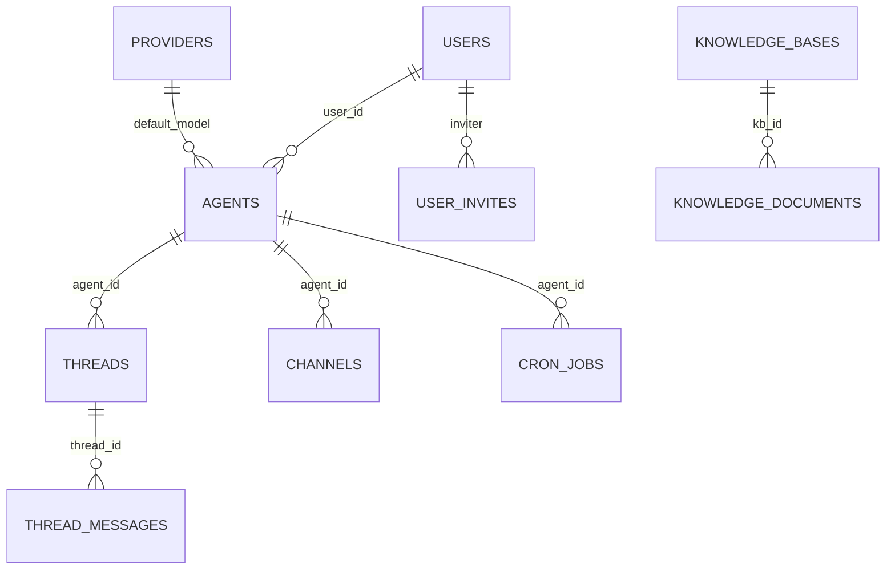

# 核心领域与数据模型总览

全仓控制面状态落在 SQLite（WAL）或 PostgreSQL，二者共享一套逻辑 schema：迁移以成对 `NNN_desc.sql` + `NNN_desc.pg.sql` 提交，当前 `_schema_version = 13`（`src/octop/infra/db/migrate.py:37`、`:1417`，`tests/unit/db/test_db_pool.py:95`）。资源表统一用整数 `id` 代理主键 + 字符串 `{entity}_id` 公开 UNIQUE 键，子表外键一律引用字符串 ID（`AGENTS.md:242`）。

## 1. 实体与存储关系图

## 2. 全库表清单与主键约束

| 表 / 载体 | 主键 / UNIQUE | 关键列 | 定义锚点（路径:行号） |
|---|---|---|---|
| `users` | `id` 整数 PK，`username` UNIQUE | `password_hash`、`role`、`locale DEFAULT 'zh'`、`email`、`sso_*`、`permissions` | `src/octop/infra/db/migrations/001_initial.sql:16`、`src/octop/infra/db/migrate.py:1175-1184` |
| `agents` | `agent_id` UNIQUE，`UNIQUE(user_id,name)` | `user_id`、`default_model`、`enabled DEFAULT 1`、`config_json`、`last_state`、`last_error` | `src/octop/infra/db/migrations/001_initial.sql:30`、`:48` |
| `providers` / `voice_providers` | `name` UNIQUE | `kind`、`models_json` | `src/octop/infra/db/migrations/001_initial.sql:52`、`:66` |
| `channels` | `channel_id` UNIQUE，`UNIQUE(agent_id,name)` | `agent_id REFERENCES agents(agent_id)` | `src/octop/infra/db/migrations/001_initial.sql:82`、`:93` |
| `cron_jobs` | `cron_id` UNIQUE | `schedule_spec`、`prompt`、`session_key`、`task_type DEFAULT 'agent' CHECK(...)`、`last_status`、`last_error` | `src/octop/infra/db/migrations/001_initial.sql:96`、`:106` |
| `sessions` | `session_key` UNIQUE | `thread_id`、`unread_count` | `src/octop/infra/db/migrations/001_initial.sql:115` |
| `threads` | `thread_id` UNIQUE | `session_key`、`pinned`、`last_active` | `src/octop/infra/db/migrations/001_initial.sql:133`、`:145-146` |
| `thread_messages` / `thread_history_projection` | — | 投影状态 `ready/pending/queued/running/failed` | `src/octop/infra/db/migrations/010_thread_message_projection.sql:7`、`:22` |
| `trajectory_events` | — | 轨迹事件序列 | `src/octop/infra/db/migrations/012_trajectory_events.sql:3` |
| `connectors` | `instance_id` UNIQUE、`mcp_server_name` UNIQUE、`UNIQUE(user_id,kind)` | `shared`、`instance_id`（013 重建） | `src/octop/infra/db/migrations/001_initial.sql:150`、`:164`、`src/octop/infra/db/migrations/013_connector_instances.sql:7` |
| `connector_oauth_states` | `state` UNIQUE | `state_id` | `src/octop/infra/db/migrations/001_initial.sql:168` |
| `usage_log` | 追加日志 | `ts`、`agent_id`、`input/output/total_tokens`、`source DEFAULT 'chat'` | `src/octop/infra/db/migrations/001_initial.sql:181` |
| `settings` / `secrets` | `key` / `k` PRIMARY KEY | KV 配置与凭据 | `src/octop/infra/db/migrations/001_initial.sql:198`、`:224` |
| `storage_backends` | `name` UNIQUE | 后端配置 | `src/octop/infra/db/migrations/001_initial.sql:206` |
| `audit_log` | 追加日志 | `ts`、`actor`、`action`、`target`、`payload` | `src/octop/infra/db/migrations/001_initial.sql:231-242` |
| `proactive_care_config` | `agent_id` PK | 默认 `'09:00'`/`'22:00'`、`min_interval_hours=5`、`max_interval_hours=24` | `src/octop/infra/db/migrations/001_initial.sql:246` |
| `care_push_records` | `id` PK | 追加日志 | `src/octop/infra/db/migrations/001_initial.sql:256` |
| `skill_packages` / `published_experts` | 整数代理 + 字符串公开 ID | 007 重建 | `src/octop/infra/db/migrations/002_cron_mcp_and_skill_packages.sql:6`、`src/octop/infra/db/migrations/007_resource_identity_and_profile.sql:25` |
| `knowledge_bases` / `knowledge_documents` | `kb_id` / `doc_id` | 文档 `status` 四态 | `src/octop/infra/db/migrations/005_shared_experts_sso_knowledge.sql:5`、`:107`，`src/octop/infra/db/migrations/007_resource_identity_and_profile.sql:48`、`:75`、`:100` |
| `user_invites` | — | 邀请码 | `src/octop/infra/db/migrations/009_user_invites.sql:3` |
| `sso_providers` / `sso_login_states` | — | OIDC 配置与临时态 | `src/octop/infra/db/migrations/005_shared_experts_sso_knowledge.sql:20`、`:33` |
| `_schema_version` | 版本水印 | 当前 `v == 13` | `src/octop/infra/db/migrations/001_initial.sql:269-270`、`src/octop/infra/db/migrate.py:63-72` |

## 3. 全库存储介质与读写归属矩阵（Writer / Reader Ownership）

| 存储载体 | 权威写入方（Writers） | 读取消费方（Readers） | 并发与原子性机制 |
|---|---|---|---|
| `SqlitePool` / `PostgresPool` | `run_migrations`（`src/octop/infra/db/migrate.py:1417`） | 全部 23 个 repo | `threading.RLock` + WAL / `ConnectionPool`（`src/octop/infra/db/pool.py:33`、`:144`） |
| `users` | `UserRepo.create`（`src/octop/infra/db/repos/users.py:69`） | `authenticate_request`（`src/octop/api/deps.py:171`） | 参数化 SQL 事务 |
| `agents` | `AgentRepo.set_state`（`src/octop/infra/db/repos/agents.py:81`） | `AgentManager.start/reload`（`src/octop/infra/agents/manager.py:696`、`:1027`） | 字符串 ID 外键 |
| `threads` / `thread_messages` | `ThreadRepo.insert`（`src/octop/infra/db/repos/threads.py:155`）、`ThreadMessageRepo`（`src/octop/infra/db/repos/thread_messages.py:57`） | `src/octop/api/routers/chat/serialize.py:881`、`src/octop/api/routers/chat/history.py:260` | 投影状态机 |
| `knowledge_*` | `KnowledgeRepo`（`src/octop/infra/db/repos/knowledge.py:99`） | `retrieve_context`（`src/octop/infra/knowledge/retrieve.py:22`） | `status` 门禁 |
| `secrets` / `settings` | `SecretRepo.get_or_create`（`src/octop/infra/db/repos/secrets.py:11`）、`SettingsRepo`（`src/octop/infra/db/repos/settings.py:8`） | `_ensure_jwt_secret`（`src/octop/infra/server.py:543`） | KV 单行 |
| `~/.octop/config.json` | `load_config` 写默认值（`src/octop/config.py:401`） | `OctopServer.start`（`:291`） | **注意全量覆盖写**，见 [`../../operations/pitfalls-and-adr.md`](../../operations/pitfalls-and-adr.md) |
| `~/.octop/agents/<id>/.octop/` | `HarnessAgent.workspace` | `workspace` 路由 | 禁止 `Path.write_text` 直写（`AGENTS.md:207`） |

## 4. 共变耦合与修改清单（Co-Change Playbook）

- 新增/变更表：成对提交 `NNN_desc.sql` + `NNN_desc.pg.sql` → `migrate.py` Python helper 保持等价幂等 → 推进 `tests/unit/db/test_db_pool.py:95` 的 `v == 13` 断言 → 更新本表与 [`agent-thread-cron.md`](agent-thread-cron.md) / [`knowledge-user-provider.md`](knowledge-user-provider.md) 字段字典 → 补 repo 与单测 fixture。
- 新增 repo：同步 `RepoBundle`（`src/octop/infra/db/services.py:35`、`:63`）与 `SharedServices` 访问器（`:103-193`）。
- 严禁：用整数 `id` 做跨表外键、用字符串拼接 SQL、只改 SQLite 不改 PG 迁移（[`../../architecture/data-and-adapter.md`](../../architecture/data-and-adapter.md)）。
- **核验锚点**：`src/octop/infra/db/repos/cron.py:1`（定时任务 repo）。
- **核验锚点**：`src/octop/infra/db/repos/providers.py:1`（模型提供方 repo）。
- **核验锚点**：`src/octop/infra/db/repos/channels.py:1`（IM 通道 repo）。
