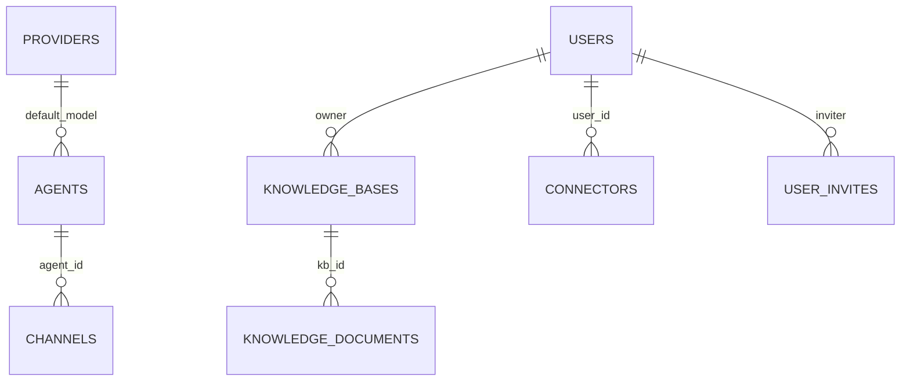

# `Knowledge` / `User` / `Provider` / `Channel` / `Connector` 聚合实体

知识库、身份、模型提供方、IM 通道与连接器构成配置面实体。共同约定：资源表用整数 `id` 代理主键 + 字符串公开 ID；`users` 例外（登录身份是 `username`，整数 `user_id` 做外键）；KV 与追加日志表不走该约定（`AGENTS.md:242`）。

## 1. 实体与存储关系图

## 2. 精确字段字典（Exact Schema Dictionary）

| 字段 / JSON 键路径 | 类型 | 必填 / 默认值 | 枚举值集合与业务约束 | 定义/校验源码锚点（路径:行号） |
|---|---|---|---|---|
| `KnowledgeBaseRow.kb_id` | `str` | 必填，公开 UNIQUE | 每用户 ≤20 库（`MAX_BASES_PER_OWNER=20`） | `src/octop/infra/db/repos/knowledge.py:22`、`src/octop/infra/knowledge/service.py:30` |
| `KnowledgeDocumentRow.status` | `str` | `"pending"` | `pending|processing|ready|failed` | `src/octop/infra/db/repos/knowledge.py:63`、`src/octop/infra/knowledge/jobs.py:44`、`:55`、`:59` |
| `KnowledgeDocumentRow.chunk_count` | `int` | — | 实际分块数，非向量数 | `src/octop/infra/knowledge/jobs.py:55` |
| `MAX_DOCS_PER_KB` / `MAX_KB_MAX_DOCUMENTS` | `int` | `100` / `10000` | 超限 `KNOWLEDGE_DOC_LIMIT(409)` | `src/octop/infra/knowledge/service.py:29`、`:33` |
| `KnowledgeCitation`（TypedDict） | `dict` | — | 检索引文结构 | `src/octop/infra/knowledge/citations.py:14` |
| `UserRow.username` | `str` | 必填，UNIQUE | 登录身份；密码策略 ≥8 位含字母数字 | `src/octop/infra/db/repos/users.py:30`、`src/octop/infra/db/migrations/001_initial.sql:16` |
| `UserRow.role` | `str` | — | `Role.ADMIN="admin"` / `Role.USER="user"` | `src/octop/infra/users/identity.py:9-11` |
| `UserRow.locale` | `str` | `'zh'` | 用户偏好优先于 `Accept-Language` | `src/octop/infra/db/migrations/001_initial.sql:16`、`AGENTS.md:263` |
| `UserRow.password_hash` | `str` | 必填 | Argon2，不明文 | `src/octop/infra/db/repos/users.py:30` |
| `ProviderRow.name` | `str` | 必填，UNIQUE | 冲突 `PROVIDER_NAME_TAKEN(409)` | `src/octop/infra/db/repos/providers.py:24`、`src/octop/infra/db/migrations/001_initial.sql:52` |
| `ProviderRow.kind` / `models_json` | `str` | — | OpenAI 兼容 / DashScope / Ollama / 本地 ONNX | `src/octop/infra/db/migrations/001_initial.sql:52` |
| `ChannelRow.channel_id` | `str` | 必填，UNIQUE | `UNIQUE(agent_id,name)` | `src/octop/infra/db/repos/channels.py:12`、`src/octop/infra/db/migrations/001_initial.sql:82` |
| `ConnectorRow.instance_id` | `str` | 必填，UNIQUE | `UNIQUE(user_id,kind)`、`shared`（013 重建） | `src/octop/infra/db/repos/connectors.py:13`、`src/octop/infra/db/migrations/013_connector_instances.sql:7` |
| `sso_login_states` | 临时行 | — | 1:1 临时态，不作资源表 | `AGENTS.md:242` |

## 3. 全库存储介质与读写归属矩阵（Writer / Reader Ownership）

| 存储载体 | 权威写入方（Writers + 路径:行号） | 读取消费方（Readers + 路径:行号） | 并发与原子性机制 |
|---|---|---|---|
| `knowledge_bases` / `knowledge_documents` | `KnowledgeRepo.create_base/create_document`（`src/octop/infra/db/repos/knowledge.py:99`） | `KnowledgeService.list_visible_bases`（`src/octop/infra/knowledge/service.py:129`）、`src/octop/infra/knowledge/retrieve.py:93` | `status` 门禁 |
| `users` | `UserRepo.create/set_*`（`src/octop/infra/db/repos/users.py:69`） | `authenticate_request`（`src/octop/api/deps.py:171`）、`UserManager`（`src/octop/infra/users/manager.py`） | 参数化 SQL 事务 |
| `providers` | `ProviderRepo.create`（`src/octop/infra/db/repos/providers.py:65`） | `_resolve_harness_model`（`src/octop/infra/gateway/process/processor.py:423`） | `find_referencing_agent_ids` 防误删 |
| `channels` | `ChannelRepo.create`（`src/octop/infra/db/repos/channels.py:40`） | `Gateway._register_channel`（`src/octop/infra/gateway/gateway.py:629`） | 字符串 `agent_id` 外键 |
| `connectors` | `ConnectorRepo.create/upsert_credentials`（`src/octop/infra/db/repos/connectors.py:79`） | `_resolve_turn_mcp_servers`（`src/octop/infra/gateway/process/processor.py:661`） | `validate_mcp_servers_for_user` |
| `audit_log` | `AuditRepo.write`（`src/octop/infra/db/repos/audit.py:39`） | `src/octop/api/routers/admin.py:47` | 追加日志 |

## 4. 共变耦合与修改清单（Co-Change Playbook）

- 改 `status` 枚举：同步 [`../../overview/glossary.md`](../../overview/glossary.md)、[`../knowledge-indexing.md`](../knowledge-indexing.md) 状态机与单测 fixture。
- 改 `users` 角色/权限：同步 `Role`（`src/octop/infra/users/identity.py:9`）、`require_permission`（`src/octop/api/deps.py:196`）、`PERMISSIONS` 键集合与前端 `useUserRole` hook。
- 改 Provider/Connector 凭据字段：同步 [`../../contracts/configuration.md`](../../contracts/configuration.md) 的 `.env.example` 组与 [`../../integrations/index.md`](../../integrations/index.md) 下游表。
- 新增字段：成对 `.sql` + `.pg.sql` 迁移 → repo dataclass → 序列化 → fixture；跑 `uv run pytest tests/unit/db tests/unit/knowledge tests/unit/users -q`。
