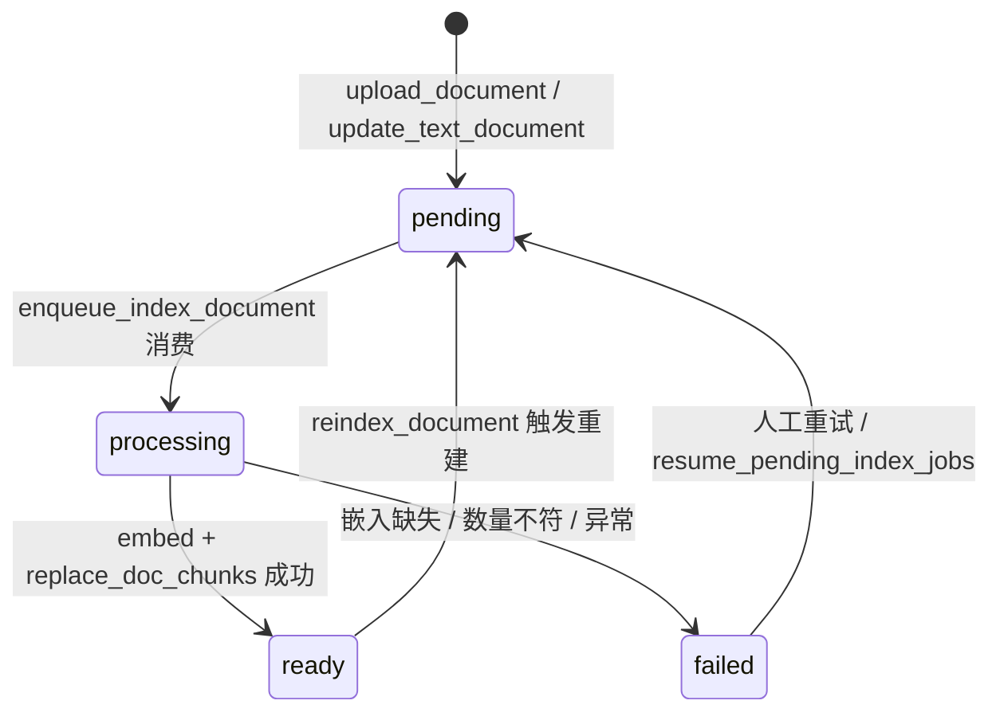

# `WF-04` · 知识库文档索引与检索

文档上传后进入 `pending → processing → ready|failed` 索引管线：分块、向量化、写入 `KnowledgeIndex`，检索时只对 `status=="ready"` 的文档取 top-k 并注入对话上下文。失败不切检索视图，重启后 `resume_pending_index_jobs` 补齐。

## 1. 符号级端到端执行调用树

```text
Trigger: 文档上传端点 (src/octop/api/routers/knowledge_bases.py)
  -> KnowledgeService.upload_document (src/octop/infra/knowledge/service.py:322) -> status="pending"
  -> enqueue_index_document (src/octop/infra/knowledge/jobs.py:63)
  -> process_document (src/octop/infra/knowledge/jobs.py:34)
  ├─ [phase] status="processing" (:44)
  ├─ [chunk] chunk_text(src/octop/infra/knowledge/chunk.py:6, size=800, overlap=120) (:49)
  ├─ [embed] embed_knowledge_texts (:52) -> POST {base}/embeddings（见 embedding-service 专页）
  ├─ [index] KnowledgeIndex(kb_id).replace_doc_chunks (:53)
  ├─ [ok] status="ready", chunk_count=len(chunks) (:55)
  └─ [err] status="failed" (:59)
Restart -> resume_pending_index_jobs (src/octop/infra/server.py:457) 补齐 pending
Query -> retrieve_context (src/octop/infra/knowledge/retrieve.py:22) -> 仅 ready 文档 (:93)
```

## 2. 分阶段业务规则与分支判定表（Exact Code Rules & Thresholds）

| 阶段 | 负责函数（路径:行号） | 精确布尔条件 / 阈值常量 | 命中分支行为 | 状态副作用 |
|---|---|---|---|---|
| 库数量上限 | `KnowledgeService` (`src/octop/infra/knowledge/service.py:30`) | `MAX_BASES_PER_OWNER=20` | 超限 → `KNOWLEDGE_BASE_LIMIT(409)` | 无 |
| 单库文档上限 | `src/octop/infra/knowledge/service.py:29`、`:33` | `MAX_DOCS_PER_KB=100`、`MAX_KB_MAX_DOCUMENTS=10_000` | 超限 → `KNOWLEDGE_DOC_LIMIT(409)` | 无 |
| 文档体积 | `src/octop/infra/knowledge/service.py:31` | `MAX_DOCUMENT_BYTES`；预览 `_MAX_PREVIEW_CHARS=200_000`（`:34`） | 超限 → `KNOWLEDGE_DOC_TOO_LARGE(413)` | 无 |
| 分块 | `chunk_text` (`src/octop/infra/knowledge/chunk.py:6-11`) | `size<=0` 或 `overlap<0 or overlap>=size` 拒绝 | 抛 `ValueError` | 无 |
| 分块参数边界 | `src/octop/infra/knowledge/params.py:17-22` | `_MIN_CHUNK_SIZE=100`、`_MAX_CHUNK_SIZE=8000`、`_MIN_RETRIEVAL_K=1`、`_MAX_RETRIEVAL_K=20`、`_MIN_CONTEXT_CHAR_BUDGET=500`、`_MAX_CONTEXT_CHAR_BUDGET=50_000` | 越界拒绝 | 设置落库 |
| 索引并发 | `src/octop/infra/knowledge/jobs.py:17` | `INDEX_CONCURRENCY=2` | 限流并发任务 | 无 |
| 单批向量 | `src/octop/infra/knowledge/embed.py:13` | 单批 ≤ `20`，超时 `60.0s` | 分批调用 | 无 |
| 检索短路 | `src/octop/infra/knowledge/retrieve.py:35` | `not query.strip() or not knowledge_base_ids or k<=0 or char_budget<=0` | 直接返回 `""`（不抛错） | 无 |
| 检索注入 | `src/octop/infra/knowledge/retrieve.py:93-95` | 仅 `document.status == "ready"` | `KnowledgeIndex.search(query_vectors[0], k=k)` | `context` 字符串 |

## 3. 实体状态机与合法迁移约束



- **不可违反的业务不变量**：只有 `status=="ready"` 的文档参与检索（`src/octop/infra/knowledge/retrieve.py:93`）；失败文档不得切在线检索视图；`chunk_count` 由实际分块数写入（`src/octop/infra/knowledge/jobs.py:55`），不是向量数。

## 4. 幂等、并发互斥与异常补偿回滚表

| 边界 / 故障场景 | 源码检测条件 | 保护/回滚/降级动作 |
|---|---|---|
| 嵌入返回 `data` 缺失 | `src/octop/infra/knowledge/embed.py:61` | 抛 `"knowledge embedding response has no data"` → 文档 `failed` |
| 向量数不匹配 | `src/octop/infra/knowledge/embed.py:64` | 抛 `"knowledge embedding count mismatch"` → 同上 |
| 进程重启时存在 pending | `src/octop/infra/server.py:457` | `resume_pending_index_jobs` 续跑 |
| 同名知识库 | `src/octop/infra/knowledge/service.py:96` → `KNOWLEDGE_NAME_TAKEN(409)` | 拒绝创建 |
| 无权限/特性关闭 | `src/octop/infra/errors.py:182`、`:185` | `KNOWLEDGE_FEATURE_DISABLED(403)` / `KNOWLEDGE_FORBIDDEN(403)` |

## 5. 共变耦合与修改清单（Agent Co-Change Playbook）

1. 改分块/检索参数：同步 `src/octop/infra/knowledge/params.py:7-22`、`get_advanced_settings`/`set_advanced_settings`（`:48`、`:82`）与前端设置页 → 更新 [`../contracts/configuration.md`](../contracts/configuration.md)。
2. 改文档状态枚举：同步 [`../overview/glossary.md`](../overview/glossary.md)、[`domain-models/knowledge-user-provider.md`](domain-models/knowledge-user-provider.md) 字段字典与单测 fixture。
3. 改嵌入请求字典：见 [`../integrations/downstream/embedding-service.md`](../integrations/downstream/embedding-service.md) 与 [`../integrations/topology-and-mapping.md`](../integrations/topology-and-mapping.md)。
4. 必跑回归：`uv run pytest tests/unit/knowledge -q`；错误分支同步 [`../contracts/error-codes.md`](../contracts/error-codes.md)。
