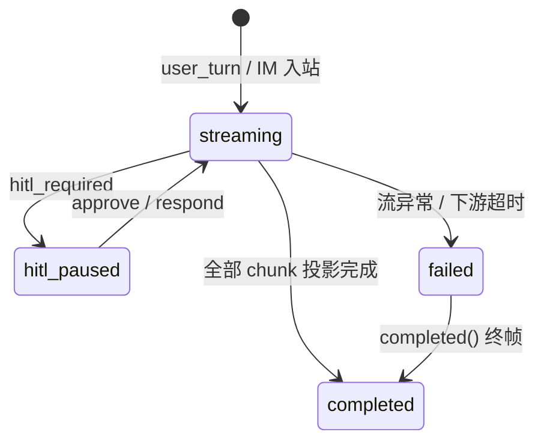

# `WF-01` · 统一消息处理与流式回复

把 Web Dashboard、IM 通道、CLI、Cron 四类触发面归一到 `GlobalProcessor`：同步校验准入 → 斜杠命令分发 → harness 请求装配 → 流式执行 → 线程/用量/历史提交。harness-agent 内部执行为仓外黑盒，本仓只负责请求字典与流投影。

## 1. 符号级端到端执行调用树（End-to-End Symbolic Call Tree）

```text
Trigger: WS "user_turn" (src/octop/api/routers/chat/ws.py:135) / IM InboundMessage / CronDelivery
  -> GlobalProcessor.__call__ (src/octop/infra/gateway/process/processor.py:517)
  ├─ [Step 1: 准入] :520 METRICS.inc("messages_total")
  │    ├─ [guard: tenant_id 空] :523 -> MessageEvent.error_event("No agent (tenant_id) specified") + completed()（短路）
  │    └─ [slash] :537 parse_slash(msg.text)
  │         ├─ approve/reject/pending -> _hitl.iter_slash_resolution (:544)
  │         ├─ cmd is None -> _hitl.resolve_ask_pending (:587)
  │         └─ _dispatcher.handle (:620) -> [if handled] completed(); return (:635)
  ├─ [Step 2: 线程与载荷] :639 get_or_create_by_key -> :648 media_backend_for_agent
  │    -> :649 build_content_from_message (src/octop/infra/gateway/process/harness_request.py:96, i < VISION_MAX_COUNT)
  │    -> :654 _resolve_harness_model (reasoning auto|enabled|disabled, :497)
  │    -> :661 _resolve_turn_mcp_servers(apply_defaults=True, raise_on_failure=False)
  ├─ [Step 3: 装配] :686 build_harness_request (src/octop/infra/gateway/process/harness_request.py:255)
  │    -> :696 _attach_turn_knowledge_config -> :706 MessageEvent.typing()
  ├─ [Step 4: 流式执行] :713 project_stream (src/octop/infra/gateway/process/stream_project.py:231) -> agent_manager.stream (:856)
  │    ├─ "hitl_required" -> register_from_request (:865)（hitl_paused）
  │    └─ "tool_result" -> enrich_tool_result_with_backend (:880)
  └─ [Step 5: 提交与收尾] :738-746 _touch_thread_after_turn + _record_turn_usage + _record_turn_history
       -> :747 completed()；异常 -> format_stream_error + 审计 "agent.stream.error" (:735)
```

## 2. 分阶段业务规则与分支判定表（Exact Code Rules & Thresholds）

| 阶段 | 负责函数（路径:行号） | 精确布尔条件 / 校验规则 / 阈值常量 | 命中分支行为 | 状态或数据副作用 |
|---|---|---|---|---|
| 准入 | `GlobalProcessor.__call__` (`src/octop/infra/gateway/process/processor.py:523`) | `agent_id = msg.tenant_id or ""` 为空 | 返回 `error_event` + `completed()` | 无写入 |
| 斜杠 | `SlashDispatcher.handle` (`src/octop/infra/gateway/slash/dispatcher.py:35`) | `_handlers.get(cmd.name)` → `runtime.has` → `tr("error.unknown_command")` | 命中即 `completed(); return`；`OctopError` → `sink.text(f"error: {exc.message}")` | 不进模型 |
| 视觉 | `build_content_from_message` (`src/octop/infra/gateway/process/harness_request.py:113`) | `i < VISION_MAX_COUNT`；`VISION_MAX_BYTES=2097152`、`VISION_MAX_COUNT=4`（`src/octop/infra/gateway/media/attachment_hints.py:44-45`） | 超限图片被截掉 | 多模态 content list |
| 响应模式 | `normalize_channel_response_mode` (`src/octop/infra/gateway/process/response_mode.py:24`) | 仅大小写不敏感 `"stream"` → stream，其余 `invoke` | `collapse_to_invoke_response` 在 `TOOL_START` 丢弃文本缓冲（`:63`） | `invoke` 单次回复 |
| 工具装配 | `_resolve_turn_mcp_servers` (`src/octop/infra/gateway/process/processor.py:661`、`:1151`) | `raise_on_failure=False` | 失败降级继续本轮；强校验场景抛 `CONNECTOR_MCP_LOAD_FAILED(502)` | `configurable.mcp_servers` |
| 历史分页 | `_serialize_history_message` (`src/octop/api/routers/chat/serialize.py:881`) | `HISTORY_DEFAULT_LIMIT=25`、`HISTORY_MAX_LIMIT=200`（`:52-53`） | 超限按 200 截断 | `messages[]` |
| 上下文窗口 | `context-usage` (`src/octop/api/routers/chat/history.py:227`) | `max_tokens=128_000` | 估算占用比 | 无写入 |

## 3. 实体状态机与合法迁移约束



- **不可违反的业务不变量**：线程键 `f"{agent_id}:{channel_type}:{channel_subject_id}:{channel_chat_type}"`（`src/octop/infra/gateway/threads.py:30`）一旦生成不可随意重排；`completed()` 终帧必须发送（`src/octop/infra/gateway/process/processor.py:747`），否则前端轮询挂死。

## 4. 幂等、并发互斥与异常补偿回滚表

| 边界 / 故障场景 | 源码检测条件（路径:行号） | 保护/回滚/降级动作 |
|---|---|---|
| 同一 session 并发两轮 | `ThreadRegistry.get_or_create_by_key` (`src/octop/infra/gateway/threads.py:149`) | 复用既有 thread，`rebind` 时才切映射 |
| 下游返回 `hitl_required` | `src/octop/infra/gateway/process/processor.py:865` | `register_from_request` 挂起，置 `StreamProjectionState.hitl_paused` |
| 下游流异常 | `src/octop/infra/gateway/process/processor.py:735`、`:909` | `format_stream_error` → `{"type":"error","message":...}` + 审计 `agent.stream.error` |
| 工具内容非法 | `src/octop/infra/gateway/process/processor.py:880` | `enrich_tool_result_with_backend` + `attachment_frames_from_tool_result` 兜底 |
| WS 未就绪 / 鉴权失败 | `src/octop/api/routers/chat/ws.py:41`、`:47`、`:55` | close `4001` / `1011`，不进处理链 |

## 5. 共变耦合与修改清单（Agent Co-Change Playbook）

- **修改本流程业务规则时必查联动点**：
  1. 入向参数与权限入口：`src/octop/api/routers/chat/ws.py:32`、`src/octop/api/routers/chat/models.py:16`；
  2. 下游字典拼装与返回解包：`src/octop/infra/gateway/process/harness_request.py:255`（契约见 [`../integrations/topology-and-mapping.md`](../integrations/topology-and-mapping.md)）；
  3. 状态枚举与前端展示同步：`dashboard/src/pages/Chat/hooks/chatStore.ts` 与 [`chat-sse-and-hitl.md`](chat-sse-and-hitl.md)；
  4. 必跑流程闭环回归单测：`uv run pytest tests/unit/gateway tests/unit/api -q`。
- **错误码联动**：新增拒绝分支须同步 [`../contracts/error-codes.md`](../contracts/error-codes.md) 与前后端 i18n 键（[`../architecture/dashboard-ui.md`](../architecture/dashboard-ui.md)）。
