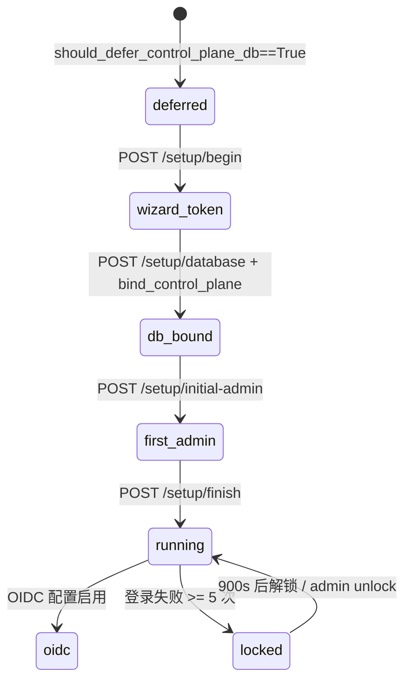

# `WF-03 · 首次安装向导与认证授权（JWT / OIDC / Setup Lockdown）`

Greenfield 安装下控制面 DB 延迟到向导选择后端后才绑定；向导期间整个过程由 `setup_lockdown` 中间件限制；绑定后 JWT 成为默认鉴权，OIDC 为可选替代。

## 1. 符号级端到端执行调用树

```text
octop run -> src/octop/launch.py:74-75 OctopServer.start()
  └─ src/octop/infra/server.py:313-317 should_defer_control_plane_db -> 只发向导密码并提前返回（_started=True）
       ├─ :315 _emit_wizard_password -> :459-487 boot_self_heal 写 ~/octop-login.txt
       └─ WizardTokenStore(ttl_seconds=300) (server.py:249；类定义 src/octop/infra/setup/wizard_tokens.py:26)

Setup Wizard -> src/octop/api/routers/setup.py
  ├─ :213 GET /api/setup/presets -> :219 validate-token -> :232 status
  ├─ :254 POST /test-database -> :272 POST /database（写 config.json database 段）
  ├─ :309 POST /begin -> :319 verify-password -> :341 initial-admin
  ├─ :378 POST /resume-wizard -> :390 test-provider -> :412 finish
  └─ 绑定 -> server.py:328-351 bind_control_plane()（幂等；open_database → run_migrations → build_shared_services → _boot_runtime）
       └─ src/octop/infra/db/rebind.py:102 rebind_control_plane（仅 user_count==0；否则 SETUP_REQUIRED/410）

HTTP 请求 -> src/octop/api/app.py:132-133 install_jwt_auth + install_setup_lockdown
  ├─ [outer] middleware/setup_lockdown.py:22 _lockdown
  │    ├─ :15 _OPEN_PREFIXES = setup/,health/；:31 open_exact = health(+docs/openapi.json 若开启)
  │    └─ :36 user_manager is None or count()==0 -> 503 {"setup_required": true}
  ├─ [inner] middleware/jwt_auth.py:37 _jwt_auth（仅 /api/* 且非豁免）
  │    ├─ src/octop/api/deps.py:66-91 _JWT_EXEMPT_PREFIXES / _JWT_EXEMPT_EXACT / is_jwt_exempt_path
  │    ├─ deps.py:112 extract_raw_token（Authorization Bearer 优先，否则 ?access_token=）
  │    ├─ deps.py:124-137 _decode / resolve_user_from_token（密钥 secret_repo.get("jwt")）
  │    │    └─ TOKEN_EXPIRED(401) / AUTH_FAILED(401) / USER_DISABLED(403)
  │    └─ deps.py:146 剩余寿命 < TTL/3 -> 响应头 X-Octop-Access-Token 滑动续期
  └─ [deps] deps.py:95 get_server / :102 require_database(未绑定 -> SETUP_REQUIRED 503)
       └─ deps.py:196 require_permission / :217 require_admin（未知权限键构造期报错，失败 FORBIDDEN 403）
```

## 2. 分阶段业务规则与精确阈值

| 阶段 | 函数（`路径:行号`） | 精确条件 / 阈值 | 命中行为 | 副作用 |
|---|---|---|---|---|
| 向导密码 | `password_file.py` + `server.py:459-487` | `config.require_setup_password` 为真时自愈生成一次性密码 | 终端横幅 + `~/octop-login.txt` | 用户登录向导 |
| 向导 token 有效期 | `server.py:249` | `WizardTokenStore(ttl_seconds=300)` | 5 分钟过期 | setup 端点校验 |
| 控制面延迟 | `server.py:313-317` | `should_defer_control_plane_db(config, paths)` | 不打开 DB，提前返回 | 后续 `/setup/*` 可用 |
| 热重绑门禁 | `rebind.py:102` | `user_count != 0` | `SETUP_REQUIRED` (410) | 拒绝换库 |
| JWT payload | `deps.py:28` (`sign_token`) | HS256，`sub/uname/role/iat/exp` | 签发 | — |
| 滑动续期阈值 | `deps.py:146`、`deps.py:61-62` | 剩余寿命 `< 1/3 TTL` | 写 `ACCESS_TOKEN_RESPONSE_HEADER` | 前端保存新 token |
| 登录锁定 | `config.py:428,432` | `OCTOP_LOGIN_MAX_ATTEMPTS=5`、`OCTOP_LOGIN_LOCKOUT_SECONDS=900` | 超限 `LOGIN_LOCKED` (429) | `users` 行锁定字段 |
| setup 限流 | `infra/errors.py:30-31` | `SETUP_PASSWORD_WRONG` (401) / `SETUP_RATE_LIMITED` (429) | 拒绝继续向导 | — |
| 管理员豁免 | `deps.py:217 require_admin` | role=admin | 跳过 agent owner 校验 | 跨用户诊断 |
| OIDC 配置 | `auth_oidc.py:68-182` | status/start/callback/exchange/config/test | 未配置时 status=false | `sso_providers` 表 |

## 3. 状态机



不可违反：`_lockdown` 必须在用户数为 0 时拦截所有非白名单路由（`setup_lockdown.py:36-40`，返回 503 + `setup_required: true`）；JWT 中间件失败直接 `JSONResponse(exc.status, exc.to_envelope())` 而非抛异常（`jwt_auth.py:52-62`）。

## 4. 幂等、并发与异常补偿

| 场景 | 检测条件（`路径:行号`） | 保护动作 |
|---|---|---|
| 重复绑定 DB | `server.py:335-337` `if self.database_bound: return` | 幂等 no-op |
| 换库时已有用户 | `rebind.py:102` | 410 拒绝，避免丢数据 |
| JWT 密钥缺失 | `server.py:543-545` `secret_repo.get_or_create("jwt", os.urandom(32))` | 启动时自动创建 32 字节随机密钥 |
| JWT 轮换 | `docs/configuration.md:222-232` `octop admin rotate-jwt-secret` | 立即失效全部在途 token |
| 安装状态漂移 | `setup.py:232 GET /setup/status` | 前端据此决定跳转 `/setup` 或 `/login` |
| OIDC callback 错误 | `auth_oidc.py:109` | `OIDC_BAD_REQUEST` (400) |

## 5. 共变耦合与修改清单（Co-Change Playbook）

1. 新增免登端点：`deps.py:66-91` 白名单，并同步 `setup_lockdown.py:15,31` 开放前缀；若漏加会被 503 拦截。
2. 改 JWT payload/TTL：`deps.py:28,47` + `config.py:424` 默认值 + 前端 `dashboard/src/api/request.ts:17,64` 滑动续期读取 → `tests/unit/auth/`。
3. 改向导步骤：`setup.py:213-412` → `bind_control_plane`（`server.py:328-351`）→ `tests/integration/test_setup_api.py`。
4. **特殊陷阱**：`docs/api.md` 中「`api/errors.py`」导航与真实实现不符，HTTP 错误映射实际在 `src/octop/api/app.py:77-98`，排查时别改错文件（见 [高危雷区](../operations/pitfalls-and-adr.md)）。

## 导航与共变索引

认证端点清单见 [管理分组接口](../contracts/api/admin-and-setup.md)，持久化表结构见 [领域模型](domain-models/index.md)，环境变量见 [配置手册](../contracts/configuration.md)。
