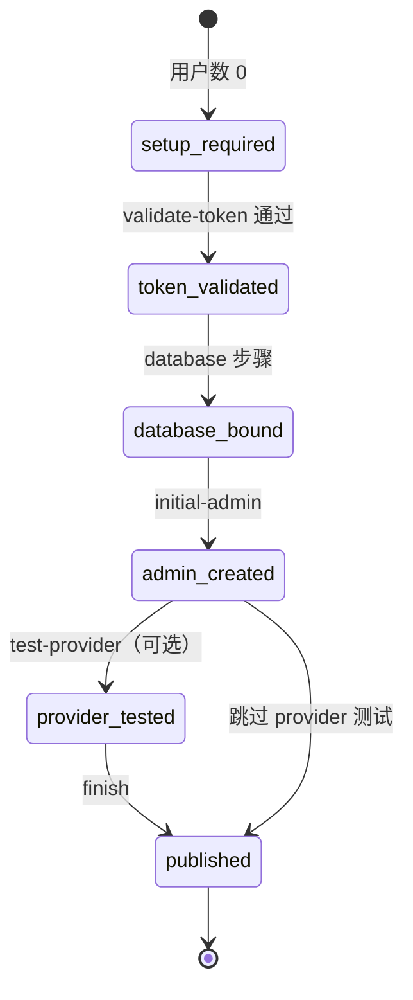

# `WF-05` · 首次安装向导

绿场（用户数为 0）时 `setup_lockdown` 仅放行 `/api/setup/*` 与 `/api/health`，向导以一次性令牌分阶段完成：验证口令 → 选数据库 → 建首管理员 → 测模型 → `finish`。`finish` 后 JWT secret 与 admin 落库，服务进入正常运行态。

## 1. 符号级端到端执行调用树

```text
Trigger: 绿场启动 (src/octop/infra/server.py:313 should_defer_control_plane_db)
  ├─ _emit_wizard_password(user_count=0) (:315) -> ensure_password (src/octop/infra/setup/password_file.py:18)
  └─ setup_lockdown (src/octop/api/middleware/setup_lockdown.py:21) 仅放行 /api/setup/ 与 /api/health
Step 1  GET /api/setup/validate-token (src/octop/api/routers/setup.py:219)
  └─ _require_wizard_token (:127) -> WizardTokenStore.validate (src/octop/infra/setup/wizard_tokens.py:39)
Step 2  POST /api/setup/database (:272) -> DatabaseSetupBody (driver "sqlite|postgresql", :73, port=5432, :76)
Step 3  POST /api/setup/begin (:309) -> _enforce_wizard_open (:105, um.count()!=0 -> 410)
Step 4  POST /api/setup/initial-admin (:341) -> Role.ADMIN (:358)
Step 5  POST /api/setup/test-provider (:390) -> probe_provider_row (见 llm-provider 专页)
Step 6  POST /api/setup/finish (:412) -> {"ok": True} (:443)
  -> open_database / run_migrations / build_shared_services / _ensure_jwt_secret (src/octop/infra/server.py:319-322)
```

## 2. 分阶段业务规则与分支判定表（Exact Code Rules & Thresholds）

| 阶段 | 负责函数（路径:行号） | 精确布尔条件 / 规则 | 命中分支行为 | 状态副作用 |
|---|---|---|---|---|
| 开放门禁 | `_enforce_wizard_open` (`src/octop/api/routers/setup.py:105`) | `um.count() != 0` → `410` | 已初始化禁止重入 | 无 |
| 令牌阶段 | `_enforce_wizard_token_phase` (`src/octop/api/routers/setup.py:111`) | token 序号 `> 1` → `410` | 拒绝越阶段 | 无 |
| 令牌限流 | `WizardTokenStore.record_attempt` (`src/octop/infra/setup/wizard_tokens.py:59`) | `RATE_LIMIT_BURST=5`、`RATE_LIMIT_WINDOW=60.0`（`:12-13`） | 超限 → `SETUP_RATE_LIMITED(429)` | 无 |
| 令牌生成 | `issue` (`src/octop/infra/setup/wizard_tokens.py:33`) | `secrets.token_urlsafe(24)`（`:34`） | 一次性令牌 | `WizardTokenStore` 内存态 |
| 口令文件 | `ensure_password` (`src/octop/infra/setup/password_file.py:18`) | `WIZARD_FILE_NAME="octop-login.txt"`（`:9`）、`_TOKEN_BYTES=16`（`:10`）、`_PASSWORD_LABEL_PREFIX="Password:"`（`:11`） | 容器首启写 `credential.txt` | 文件 `chmod 600` |
| 口令校验 | `verify-password` (`src/octop/api/routers/setup.py:319`) | 不匹配 → `SETUP_PASSWORD_WRONG(401)` | 拒绝继续 | 无 |
| 数据库 | `DatabaseSetupBody` (`src/octop/api/routers/setup.py:72-76`) | `driver ∈ {"sqlite","postgresql"}`、`port=5432` | 非法 → 400 | `config.json.database` |
| 管理员角色 | `initial-admin` (`src/octop/api/routers/setup.py:341`、`:358`) | `Role.ADMIN` | 创建首管理员 | `users` 行 |
| 绿场延迟建库 | `should_defer_control_plane_db` (`src/octop/infra/server.py:313`) | 空库为真 | 只发向导口令、不装配 `SharedServices` | `services` 暂为 None |

## 3. 实体状态与合法迁移约束



- **不可违反的业务不变量**：`finish` 前 `SharedServices` 未装配，任何业务接口被 `setup_lockdown` 拦为 `503 {"setup_required": true}`（`src/octop/api/middleware/setup_lockdown.py:36-40`）；JWT secret 必须在 `_ensure_jwt_secret` 用 `os.urandom(32)` 生成（`src/octop/infra/server.py:545`）。

## 4. 幂等、并发互斥与异常补偿回滚表

| 边界 / 故障场景 | 源码检测条件 | 保护/回滚/降级动作 |
|---|---|---|
| 重复 finish | `_enforce_wizard_open` (`src/octop/api/routers/setup.py:105`) | `410` 拒绝，不重复建库/建管理员 |
| 令牌重放 | `WizardTokenStore.consume` (`src/octop/infra/setup/wizard_tokens.py:51`) | 一次性消费，重放 → `SETUP_TOKEN_INVALID` |
| 数据库已非空 | `ErrorCode.DATABASE_NOT_EMPTY(409)`（`src/octop/infra/errors.py:17`） | 拒绝重复初始化 |
| Docker 首启默认凭据 | `OCTOP_ADMIN_USERNAME=admin`、`OCTOP_DEFAULT_PASSWORD=Octop123` | 写 `credential.txt` 后 `chmod 600`（`docker/docker-entrypoint.sh:34`） |
| 未配置 LLM | `test-provider` 探测失败 | 可跳过，`finish` 后仍可在 Dashboard 配置 |

## 5. 共变耦合与修改清单（Agent Co-Change Playbook）

1. 改向导步骤/令牌规则：同步 `src/octop/api/routers/setup.py:105-139`、`src/octop/infra/setup/wizard_tokens.py:12-59` 与前端安装页 → 更新 [`../contracts/api/auth-and-users.md`](../contracts/api/auth-and-users.md) 的 setup 路由表。
2. 改错误语义：同步 [`../contracts/error-codes.md`](../contracts/error-codes.md) 的 `SETUP_*` 项与前后端 i18n 键。
3. 改数据库装配：核对 `src/octop/infra/server.py:319-323` 与 [`../architecture/data-and-adapter.md`](../architecture/data-and-adapter.md) 的双驱动迁移。
4. 必跑回归：`uv run pytest tests/unit/api tests/unit/setup -q`；Docker 首启验证见 [`../operations/deployment-and-runtime.md`](../operations/deployment-and-runtime.md)。
- **核验锚点**：`src/octop/infra/users/identity.py:1`（用户与角色实体定义）。
