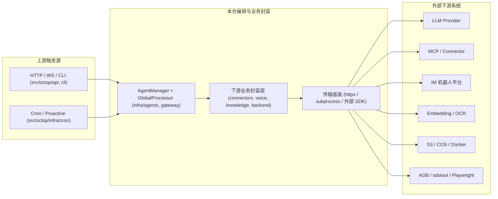

# 上下游集成与调用拓扑总览

Octop 是单仓工作区：所有「下游」都是外部黑盒服务、宿主 CLI 或外部 Python 包；本仓只实现业务封装层（请求字典组装、签名、返回解包与错误翻译），真实服务端实现均不在仓库内。

## 1. 上下游调用拓扑图

## 2. 仓内组件「上游有谁 ↔ 下游调谁」双向速查表

| 本仓组件 / 模块 | 源码路径 | 直接上游调用方（`路径:行号`） | 仓内下游模块 | 外部下游封装 | 架构页 |
|---|---|---|---|---|---|
| API 接入 | `src/octop/api/` | Dashboard / CLI / MCP Client | `infra/agents`、`infra/gateway` | — | [`api-service.md`](../architecture/api-service.md) |
| Agent 运行时 | `infra/agents/manager.py` | `server.py:364-370`、`processor.py:856` | `infra/connectors`、`infra/knowledge` | [LLM Provider](downstream/llm-providers.md)、[MCP](downstream/connectors-mcp.md) | [`core-engine.md`](../architecture/core-engine.md) |
| Gateway 处理 | `infra/gateway/process/processor.py` | `ws.py:168`、`channels.py` | `infra/agents`、`infra/db` | [IM 渠道](downstream/im-channels.md) | [`chat-turn.md`](../business/chat-turn.md) |
| 定时任务 | `infra/cron/` | `server.py:405-419` | `infra/gateway`、`infra/agents` | [LLM Provider](downstream/llm-providers.md) | [`async-job-worker.md`](../architecture/async-job-worker.md) |
| 存储与工作区 | `infra/backend/` | `manager.py:2649-2678`、`storage_backends.py` | `infra/db` | [Storage Backends](downstream/storage-backends.md) | [`data-and-adapter.md`](../architecture/data-and-adapter.md) |
| 语音 | `infra/voice/` | `voice.py:112,133` | — | [Voice & Media](downstream/voice-and-media.md) | [`ui-and-cli.md`](../architecture/ui-and-cli.md) |
| 知识 | `infra/knowledge/` | `knowledge_bases.py`、`middleware` | `infra/db` | [Knowledge RAG](downstream/knowledge-rag.md) | [`knowledge-rag.md`](downstream/knowledge-rag.md) |
| 设备桥 | `infra/{mobile,desktop,browser}/` | `*/stream.py` WS 端点 | — | [Device Bridges](downstream/device-bridges.md) | [`ui-and-cli.md`](../architecture/ui-and-cli.md) |

## 3. 外部下游依赖系统全量清单（Downstream Registry）

> **传输底座 vs 业务封装层**：`httpx`/`subprocess`/外部 SDK 只是底座；真正组装业务字典的文件在「本仓业务封装」列，严禁只看底座就宣称契约已覆盖。封装定位证据：`src/octop/infra/connectors/gateway/protocol.py:21`、`src/octop/infra/agents/providers/store.py:130`、`src/octop/infra/voice/adapters.py:68`、`src/octop/infra/backend/adapter.py:44`、`src/octop/infra/knowledge/embed.py:16`、`src/octop/infra/gateway/bot_creators/feishu_bot_creator.py:225`。

| 下游系统 | 业务职责 | 协议 / 成功判定 | 传输底座（`路径:行号`） | 本仓业务封装文件 | 封装方法数 | 出向字典契约专页 |
|---|---|---|---|---|---|---|
| LLM Provider / Harness | 模型推理、agent runtime | `ProviderConfig`/`ModelConfig`；`iter_usable_rows` 过滤 | `harness_agent`（外部包） | `infra/agents/providers/{store,probe,reasoning}.py` | 8 | [`llm-providers.md`](downstream/llm-providers.md) |
| Connector / MCP 网关 | 13 类外部工具 | JSON-RPC `_ok/_err`；`result.content[].text` | `httpx`/`subprocess`/`imaplib` | `infra/connectors/gateway/{protocol,registry,adapters/*}.py` | 13 adapter + 6 OAuth | [`connectors-mcp.md`](downstream/connectors-mcp.md) |
| IM 机器人平台 | 飞书/元宝/钉钉/企微/QQ 扫码建机器人与推送 | `errcode/code==0` | `lark-oapi`/`urllib`/外部 SDK | `infra/gateway/bot_creators/*`、`channels/*` | 5 类 | [`im-channels.md`](downstream/im-channels.md) |
| Embedding / OCR / RAG | 文档向量化与检索注入 | `data[].embedding` 条数一致 | `httpx`/本地 ONNX | `infra/knowledge/{embed,index,retrieve,ocr,jobs}.py` | 7 | [`knowledge-rag.md`](downstream/knowledge-rag.md) |
| 存储后端 | S3/COS/OSS/Docker/OpenSandbox 工作区 | spec 写入/读回比对 | 外部 `BackendProtocol` | `infra/backend/{adapter,probe,browse}.py` | 8 种 spec | [`storage-backends.md`](downstream/storage-backends.md) |
| 语音 STT/TTS | 6 类转写合成后端 | `Response.Result/Audio`、`choices[0]` | `httpx`/`edge_tts` | `infra/voice/{adapters,tencent_sign,manager}.py` | 6 | [`voice-and-media.md`](downstream/voice-and-media.md) |
| 设备桥 | ADB/xdotool/Playwright 远程控制 | argv 退出码 + 帧解析 | `subprocess.run` | `infra/mobile/adb.py`、`infra/desktop/*`、`infra/browser/setup.py` | 14 类命令 | [`device-bridges.md`](downstream/device-bridges.md) |

**跨仓依赖**：单仓模式，无 `repo_deps` 跨仓边；外部依赖均为 PyPI 包或远端服务，逐条证据见 [`module-dep-matrix.md`](../architecture/module-dep-matrix.md) 与 [边界声明](../operations/boundary.md)。字段级映射统一查 [`topology-and-mapping.md`](topology-and-mapping.md)。

## 4. 导航与维护

新增下游系统时必须同步本注册表、[字段映射](topology-and-mapping.md)、[入向接口参考](../contracts/api-reference.md) 与对应 `downstream/<target>.md` 契约页；修改任一请求字典前先用 [术语表](../overview/glossary.md) 锁定命名，再按 [单测映射](../operations/dev-and-test.md) 跑对应回归。
