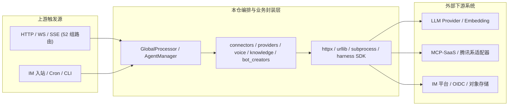

# 上下游集成与调用拓扑总览

汇总全仓「上游被谁调 ↔ 下游调了谁」的双向拓扑，并完整登记所有外部下游依赖系统。**强制区分传输底座与业务封装层**：本仓没有单一 `BaseAdapter`，取而代之的是 `httpx`/`urllib`/`subprocess`/harness SDK 四类传输，其上的业务字典组装层分散在 `infra/connectors/`、`infra/agents/providers/`、`infra/voice/`、`infra/knowledge/`、`infra/gateway/bot_creators/` 等目录，每个下游系统均在 [`downstream/`](topology-and-mapping.md) 独立成篇并展开完整请求/返回字典 Key。

## 1. 上下游调用拓扑图（Inbound ↔ Internal ↔ Outbound）

## 2. 仓内组件「上游有谁 ↔ 下游调谁」双向速查表

| 本仓组件 / 模块 | 源码路径 | 直接上游调用方（符号 + 路径:行号） | 调用的仓内下游模块 | 调用的外部下游封装 | 组件架构页 |
|---|---|---|---|---|---|
| Provider 探测 | `src/octop/infra/agents/providers/probe.py` | `probe_provider_row`（`src/octop/api/routers/providers.py:311`） | `store.py` / `onnx_service.py` | [`llm-provider`](downstream/llm-provider.md) | [../architecture/agent-runtime.md](../architecture/agent-runtime.md) |
| Connector/MCP 网关 | `src/octop/infra/connectors/` | `probe_connector`（`src/octop/api/routers/connectors.py:944`）、`handle_mcp_request`（`src/octop/api/routers/internal_mcp.py:82`） | `builder.py` / `service.py` / `gateway/registry.py` | [`mcp-gateway`](downstream/mcp-gateway.md)、[`connector-adapters`](downstream/connector-adapters.md)、[`tencent-ima`](downstream/tencent-ima.md)、[`tencent-news`](downstream/tencent-news.md)、[`qq-music`](downstream/qq-music.md)、[`baidu-map`](downstream/baidu-map.md)、[`weknora`](downstream/weknora.md) | [../architecture/index.md](../architecture/index.md) |
| 飞书建机器人 | `src/octop/infra/gateway/bot_creators/feishu_bot_creator.py` | `src/octop/cli/support/feishu_creator.py:39` | `feishu_runner.py` 子进程 | [`feishu-channel`](downstream/feishu-channel.md) | [../architecture/async-worker.md](../architecture/async-worker.md) |
| 元宝机器人 | `src/octop/infra/gateway/bot_creators/yuanbao_bot_creator.py` | `gateway/channels/qr_bind.py` | 宿主 metadata 服务 | [`yuanbao-channel`](downstream/yuanbao-channel.md) | [../architecture/async-worker.md](../architecture/async-worker.md) |
| 通道二维码绑定 | `src/octop/infra/gateway/channels/qr_bind.py`、`dingtalk_registration.py` | `src/octop/api/routers/channels.py:454` | harness-gateway QR 类 | [`channel-qr-bind`](downstream/channel-qr-bind.md) | [../architecture/api-service.md](../architecture/api-service.md) |
| 语音适配 | `src/octop/infra/voice/adapters.py` | `src/octop/infra/voice/manager.py:113` | — | [`voice-provider`](downstream/voice-provider.md) | [../architecture/index.md](../architecture/index.md) |
| 知识向量化 | `src/octop/infra/knowledge/embed.py` | `src/octop/infra/knowledge/jobs.py:52` | `onnx_service.py` | [`embedding-service`](downstream/embedding-service.md) | [../business/knowledge-indexing.md](../business/knowledge-indexing.md) |
| 工作区后端 | `src/octop/infra/backend/resolver.py` | `infra/agents/manager.py` | `adapter.py` / `probe.py` | [`storage-backend`](downstream/storage-backend.md) | [../architecture/data-and-adapter.md](../architecture/data-and-adapter.md) |
| SSO/OIDC | `src/octop/infra/auth/sso/` | `src/octop/api/routers/auth_oidc.py:74` | `service.py` / `id_token.py` | [`oidc-provider`](downstream/oidc-provider.md) | [../business/setup-wizard.md](../business/setup-wizard.md) |
| 外部 CLI/子进程 | `src/octop/infra/connectors/gateway/cli_runner.py` | `src/octop/infra/connectors/gateway/adapters/feishu_cli.py:150` | `cli_install.py` | [`external-cli-runners`](downstream/external-cli-runners.md) | [../overview/callchain-panorama.md](../overview/callchain-panorama.md) |

## 3. 外部下游依赖系统全量清单（Downstream Registry）

| 下游系统名 | 承担业务职责 | 协议与成功码判定 | 底层传输（路径:行号） | **本仓业务封装文件（组装参数层）** | 超时 / 重试 | 出向字典契约专页 |
|---|---|---|---|---|---|---|
| `llm-provider` | 模型探测、models/embeddings 心跳 | `HTTP 200` 且 `data[0].embedding` 非空 | `httpx`（`src/octop/infra/agents/providers/probe.py:174`） | `probe.py`、`store.py` | `30.0s`（`src/octop/infra/connectors/probe.py:19`） | [downstream/llm-provider.md](downstream/llm-provider.md) |
| `embedding-service` | 知识文档向量化 | `response["data"]` 数量与 batch 匹配 | `httpx`（`src/octop/infra/knowledge/embed.py:53`） | `embed.py` | `60.0s`，单批 ≤20（`src/octop/infra/knowledge/embed.py:13`） | [downstream/embedding-service.md](downstream/embedding-service.md) |
| `voice-provider` | STT / TTS（OpenAI、腾讯云、Mimo） | `{"ok": True}` / `body["text"]` | `httpx`（`src/octop/infra/voice/adapters.py:68`） | `adapters.py` | `60.0s`/`120.0s` | [downstream/voice-provider.md](downstream/voice-provider.md) |
| `mcp-gateway` | MCP JSON-RPC、OAuth、CLI runner | `{"tools":[…]}` / `result.content[].text` | `httpx` + `subprocess.run`（`src/octop/infra/connectors/gateway/cli_runner.py:38`） | `probe.py`、`builder.py`、`oauth/mcp.py`、`gateway/protocol.py` | `20.0s`/`30.0s`（`src/octop/infra/connectors/gateway/cli_runner.py:11`） | [downstream/mcp-gateway.md](downstream/mcp-gateway.md) |
| `tencent-ima` | 腾讯 IMA 笔记/知识库读写 | `data["code"] ∈ {0,None,"0"}` | `httpx`（`src/octop/infra/connectors/gateway/adapters/tencent_ima.py:459`） | `tencent_ima.py` | `60.0s` | [downstream/tencent-ima.md](downstream/tencent-ima.md) |
| `tencent-news` | 资讯检索 | `base_rsp["code"] ∈ {0,None,"0"}` | `httpx`（`src/octop/infra/connectors/gateway/adapters/tencent_news.py:72`） | `tencent_news.py` | `30.0s` | [downstream/tencent-news.md](downstream/tencent-news.md) |
| `qq-music` | 音乐检索 | `payload["ret"]` 且非 `11534343` | `httpx`（`src/octop/infra/connectors/gateway/adapters/qq_music.py:124`） | `qq_music.py` | `30.0s` | [downstream/qq-music.md](downstream/qq-music.md) |
| `baidu-map` | 地点/路线/天气 | `status ∈ {0}` 或 `message=="ok"` | `httpx`（`src/octop/infra/connectors/gateway/adapters/baidu_map.py:71`） | `baidu_map.py` | `30.0s` | [downstream/baidu-map.md](downstream/baidu-map.md) |
| `weknora` | 知识问答检索 | `payload["success"]` | `httpx`（`src/octop/infra/connectors/gateway/adapters/weknora.py:187`） | `weknora.py` | 见专页 | [downstream/weknora.md](downstream/weknora.md) |
| `connector-adapters` | 携程/美团/飞猪/微信读书/原点/QQ邮箱/企微/飞书 CLI 适配器族 | 各适配器自有 `code`/`ret` 判定 | `httpx` + `run_cli` | `gateway/adapters/*.py`（8 个） | `30.0s` | [downstream/connector-adapters.md](downstream/connector-adapters.md) |
| `feishu-channel` | 飞书自建机器人注册与发问候 | `tenant_access_token` 非空 / `level=="success"` | `urllib` + `subprocess.Popen`（`src/octop/infra/gateway/bot_creators/feishu_runner.py:42`） | `feishu_bot_creator.py` | `proc.wait(timeout=5)` | [downstream/feishu-channel.md](downstream/feishu-channel.md) |
| `yuanbao-channel` | 元宝机器人扫码绑定 | `resp["code"]==0`，`data["status"]==2` | `urllib`（`src/octop/infra/gateway/bot_creators/yuanbao_bot_creator.py:191`） | `yuanbao_bot_creator.py` | `30s`，`POLL_INTERVAL=3` | [downstream/yuanbao-channel.md](downstream/yuanbao-channel.md) |
| `channel-qr-bind` | 企微/QQ/微信/钉钉二维码绑定 | `data["status"]=="success"` / `errcode==0` | `httpx` + harness QR（`src/octop/infra/gateway/channels/qr_bind.py:26`） | `qr_bind.py`、`dingtalk_registration.py` | `wait_for_login(60.0)` / `15.0s` | [downstream/channel-qr-bind.md](downstream/channel-qr-bind.md) |
| `storage-backend` | COS/S3/Docker/OpenSandbox 工作区 | `{"ok": True}`（probe 往返） | harness SDK（`src/octop/infra/backend/resolver.py:23`） | `adapter.py`、`probe.py` | 由后端决定 | [downstream/storage-backend.md](downstream/storage-backend.md) |
| `oidc-provider` | OIDC 发现/改码/JWKS 校验 | `discovery["issuer"]` 匹配 + `claims["nonce"]` | `httpx`（`src/octop/infra/auth/sso/discovery.py:18`） | `service.py`、`id_token.py` | `Timeout(10.0, connect=5.0)` | [downstream/oidc-provider.md](downstream/oidc-provider.md) |
| `external-cli-runners` | ACP runner / 自更新 / 桌面移动安装 | `returncode==0` / `status==0` | `subprocess`（`src/octop/infra/setup/self_update.py:195`） | `self_update.py`、`desktop/setup.py`、`mobile/adb.py` | `120s`/`30s` | [downstream/external-cli-runners.md](downstream/external-cli-runners.md) |

> **harness 黑盒边界**：`harness-agent`/`harness-gateway`/`harness-memory`/`harness-browser` 以 wheel 依赖同进程注入，聊天模型调用、对象存储 I/O、ACP 子进程派生、远程 OCR 的**服务端内部实现不在本仓**；各专页只记录本仓组装的边界字典与返回解包键，严禁推测远端字段。详见 [`../operations/boundary.md`](../operations/boundary.md)。

## 4. 共变耦合与修改清单（Co-Change Playbook）

- **新增下游系统**：在 `infra/` 下新建业务封装文件 → 在此表登记传输/超时/成功码 → 独立写 [`downstream/<target>.md`](downstream/llm-provider.md) 展开全部字典 Key → 更新 [`topology-and-mapping.md`](topology-and-mapping.md) 字段映射 → 补 [`../contracts/error-codes.md`](../contracts/error-codes.md) 翻译条目与单测桩。
- **改任一下游方法签名**：按各专页第 2 节「上游调用方反查表」逐一核对调用点，运行 `uv run pytest tests/unit/connectors tests/unit/providers -q`。
- **凭据变更**：地址与 Token 一律走配置项（[`../contracts/configuration.md`](../contracts/configuration.md)），禁止硬编码 `*.woa.com` 或内部平台地址。
