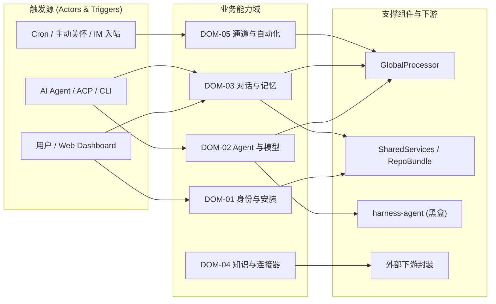

# 业务架构全景

Octop 面向「管理员 + 普通用户 + AI Agent + 定时器」四类触发源，把 Web 控制台、IM（飞书/钉钉/QQ/Discord/企微）、CLI 与 Cron 统一收敛到进程内 `GlobalProcessor`，每个用户拥有隔离的 Agent、工作区、凭据与对话线程。业务闭环覆盖「首次安装 → 配置模型/通道 → 对话与工具执行 → 知识库检索 → 定时推送 → 备份/升级」。

## 1. 角色触发源与业务域拓扑

## 2. 业务域边界与能力矩阵

| 业务域标识 | 业务域名称 | 核心业务职责 | 核心状态实体 | 归属代码模块 | 核心准入/配额约束 | 关联业务清单 |
|---|---|---|---|---|---|---|
| `DOM-01` | 身份与安装 | 首启向导、JWT 多用户隔离、权限与审计 | `users`、`sso_providers`、`user_invites` | `infra/users/`、`infra/setup/`、`api/routers/auth.py` | 用户数为 0 才开放向导（`src/octop/api/routers/setup.py:105`） | [业务总表](../business/index.md) |
| `DOM-02` | Agent 与模型 | Agent 生命周期、Provider/技能/专家装配 | `agents`、`providers`、`skill_packages` | `infra/agents/`、`api/routers/agents.py` | 归属校验 `_assert_agent_owner`（`src/octop/api/common/agent.py:23`） | [业务总表](../business/index.md) |
| `DOM-03` | 对话与记忆 | 多面统一消息处理、HITL 审批、线程与记忆 | `threads`、`thread_messages`、`trajectory_events` | `infra/gateway/`、`api/routers/chat/` | 线程键 `agent_id:channel_type:subject:chat_type`（`src/octop/infra/gateway/threads.py:30`） | [对话流程](../business/message-processing.md) |
| `DOM-04` | 知识与连接器 | 文档索引、向量检索、OAuth/MCP 工具网关 | `knowledge_bases`、`knowledge_documents`、`connectors` | `infra/knowledge/`、`infra/connectors/` | 每库 ≤100 文档、每用户 ≤20 库（`src/octop/infra/knowledge/service.py:29-30`） | [知识索引流程](../business/knowledge-indexing.md) |
| `DOM-05` | 通道与自动化 | IM 绑定、Cron 触发、主动关怀、自动备份 | `channels`、`cron_jobs`、`proactive_care_config` | `infra/gateway/`、`infra/cron/`、`infra/proactive/`、`infra/backup/` | 触发器仅 `interval`/`cron`/`date`（`src/octop/infra/cron/trigger.py:62`） | [定时任务流程](../business/cron-automation.md) |

## 3. 全量业务流程主索引（`WF-*`）

| 流程 ID | 流程名称 | 触发入口（路由 / 定时器 / 命令） | 串联组件与下游（按执行序） | 关键状态迁移 | 流程专页 |
|---|---|---|---|---|---|
| `WF-01` | 统一消息处理与流式回复 | WS `user_turn` (`src/octop/api/routers/chat/ws.py:135`) / IM 入站 / Cron | `GlobalProcessor → 斜杠分发 → harness_request → agent_manager.stream → SSE/WS` | `queued → streaming → completed / hitl_paused` | [message-processing.md](../business/message-processing.md) |
| `WF-02` | HITL 审批与流式会话 | `POST /api/agents/{id}/chat/hitl/resume` (`src/octop/api/routers/chat/routes.py:156`) | `routes.iter_dashboard_hitl_resume_sse → processor.resume_hitl → SSE` | `pending → approved / rejected → done` | [chat-sse-and-hitl.md](../business/chat-sse-and-hitl.md) |
| `WF-03` | 定时任务与主动推送 | `CronManager._schedule` (`src/octop/infra/cron/manager.py:236`) | `AsyncIOScheduler → CronJob.run → CronDeliveryService.deliver → stream` | `ok / error`（写 `last_status`） | [cron-automation.md](../business/cron-automation.md) |
| `WF-04` | 知识库文档索引与检索 | 文档上传端点 (`api/routers/knowledge_bases.py`) | `upload_document → enqueue_index_document → chunk_text → embed → KnowledgeIndex.replace_doc_chunks` | `pending → processing → ready / failed` | [knowledge-indexing.md](../business/knowledge-indexing.md) |
| `WF-05` | 首次安装向导 | `POST /api/setup/begin` (`src/octop/api/routers/setup.py:309`) | `validate-token → database → initial-admin → test-provider → finish` | `setup_required → token → admin → published` | [setup-wizard.md](../business/setup-wizard.md) |

业务域 ↔ 接口组 ↔ 错误码 ↔ 配置键的交叉速查见 [`business/index.md`](../business/index.md)；全量 422 条入向接口见 [`contracts/api-reference.md`](../contracts/api-reference.md)。

## 4. 全局业务不变量（不可破坏的业务红线）

1. **权限与资源归属不变量**：除白名单与 admin 豁免，所有 agent 维度操作必须加载 agent 行并校验 owner —— 校验锚点 `src/octop/api/common/agent.py:23`；JWT 用户由 `src/octop/api/deps.py:171` 的 `authenticate_request` 解析。
2. **单进程状态重建不变量**：进程重启从 `~/.octop/octop.db` 重建，无外部消息队列 —— 锚点 `src/octop/infra/server.py:319-323` 与 `docs/adr/001-single-process-model.md:1`；任务状态为内存态，重启即清空。
3. **写时契约闭合不变量**：数据库 schema 变更必须成对提交 `.sql` + `.pg.sql` 并推进 `_schema_version`（当前 `v == 13`）—— 锚点 `src/octop/infra/db/migrate.py:37`、`:1417` 与 `tests/unit/db/test_db_pool.py:95`。
4. **凭据安全不变量**：JWT secret 经 `secret_repo.get_or_create("jwt", os.urandom(32))` 生成（`src/octop/infra/server.py:543-545`），通道 Token 与连接器凭据不明文回显、不进日志 —— 锚点 `src/octop/infra/db/repos/secrets.py:11`、`.env.example:77`。
5. **工作区 IO 不变量**：Agent 工作区内容读写必须经 `HarnessAgent.workspace`（`AGENTS.md:207`），禁止 `Path.write_text` 直接落盘，防止绕过 backend 路径规则。
- **核验锚点**：`src/octop/infra/gateway/process/processor.py:1`（统一消息处理入口）。
