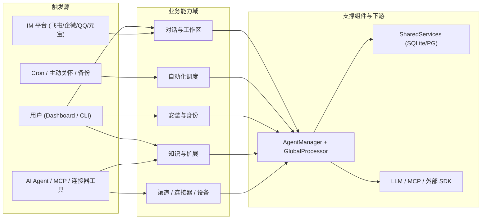

# 业务架构全景

Octop 面向「多用户共享一台自托管 AI 助手」场景：用户、AI Agent、IM 平台与定时器四类触发源，共用同一 harness 运行时；业务域围绕对话、自动化、安装身份、知识、渠道工具与设备控制展开。

## 1. 角色触发源与业务域拓扑

## 2. 业务域边界与能力矩阵

| 业务域标识 | 业务域名称 | 核心业务职责 | 核心状态实体 | 归属代码模块 | 准入 / 配额约束 | 关联清单 |
|---|---|---|---|---|---|---|
| `DOM-01` | 对话与工作区 | 多入口回合、slash 命令、HITL、文件与媒体 | `sessions`、`threads`、`thread_messages` | `api/routers/chat/`、`infra/gateway/` | agent 归属 + running 状态 + WS 权限 | [`WF-01`](../business/chat-turn.md) |
| `DOM-02` | 自动化调度 | Cron 任务、主动关怀、自动备份/TLS 续期 | `cron_jobs`、`proactive_care_config`、`care_push_records` | `infra/cron/`、`infra/proactive/`、`infra/backup/` | 触发器合法、`task_type∈{text,agent}`、prompt≤2000 | [`WF-02`](../business/cron-and-proactive.md) |
| `DOM-03` | 安装与身份 | 首次向导、JWT/OIDC、用户/邀请/权限 | `users`、`secrets`、`sso_providers`、`user_invites` | `api/routers/setup|auth|users`、`infra/users/`、`infra/auth/` | setup lockdown 零用户锁定、登录 5 次锁定 900s | [`WF-03`](../business/setup-and-auth.md) |
| `DOM-04` | 知识与扩展 | 文档索引/检索、技能包、专家、插件、MBTI | `knowledge_bases`、`skill_packages`、`published_experts` | `infra/knowledge/`、`infra/skills/`、`plugins/` | `INDEX_CONCURRENCY=2`、OCR/embedding 前置门禁 | [`WF-04`](../business/index.md) |
| `DOM-05` | 渠道与工具 | IM 机器人绑定、连接器/MCP、设备远程控制 | `channels`、`connectors`、`connector_oauth_states` | `infra/gateway/`、`infra/connectors/`、`infra/{mobile,desktop,browser}/` | 凭证校验、kind 注册、平台权限 | [`WF-05/07/08`](../business/index.md) |

## 3. 全量业务流程主索引（`WF-*`）

| 流程 ID | 流程名称 | 触发入口（`路径:行号`） | 串联组件与下游 | 关键状态迁移 | 流程专页 |
|---|---|---|---|---|---|
| `WF-01` | 对话回合 | `WS /api/agents/{aid}/chat/ws` (`api/routers/chat/ws.py:32`) | `WS → processor → harness → 投影 → usage/trajectory` | authenticated→prepared→running→completed/hitl | [`chat-turn.md`](../business/chat-turn.md) |
| `WF-02` | 定时任务与主动关怀 | `CronManager.create` (`infra/cron/manager.py:105`) | `APScheduler → delivery → Gateway → harness/push` | scheduled→running→ok/error | [`cron-and-proactive.md`](../business/cron-and-proactive.md) |
| `WF-03` | 向导与认证授权 | `POST /api/setup/database` (`api/routers/setup.py:272`) | `lockdown → wizard → bind DB → JWT/OIDC` | deferred→wizard→db_bound→running | [`setup-and-auth.md`](../business/setup-and-auth.md) |
| `WF-04` | 文档索引与检索 | `POST /api/knowledge-bases/{kb}/documents` (`knowledge_bases.py:692`) | `parse→chunk→embed→index→citation` | pending→processing→ready/failed | [`knowledge-rag.md`](../integrations/downstream/knowledge-rag.md) |
| `WF-05` | IM 机器人绑定 | `channels.py:454` 等 QR/bot-creator | `channels API → 外部 SDK → channels 行` | pending→bound | [`im-channels.md`](../integrations/downstream/im-channels.md) |
| `WF-06` | 备份与恢复 | `server.py:417-419` | `system cron → snapshot/pg_dump → tar.gz` | idle→running→ok/error | [`runbook-and-observability.md`](../operations/runbook-and-observability.md) |
| `WF-07` | 连接器 MCP 装配 | `connectors.py:662` | `凭证 → spec → registry → LangChain tool` | unbound→bound→tested | [`connectors-mcp.md`](../integrations/downstream/connectors-mcp.md) |
| `WF-08` | 设备远程流 | `mobile/stream.py:481` 等 WS | `WS → ADB/xdotool/Playwright → 帧` | 运行期帧，无持久化 | [`device-bridges.md`](../integrations/downstream/device-bridges.md) |

全量索引与域↔接口↔错误码↔配置键交叉表见 [`business/index.md`](../business/index.md)；归属校验权威锚点 `src/octop/infra/gateway/process/processor.py:529`（user_id 解析）与 `src/octop/infra/db/repos/agents.py`（agent 行归属读写）。

## 4. 全局业务不变量（不可破坏的业务红线）

1. **权限与资源归属不变量**：所有 agent 路由必须加载 agent 行后 `_assert_agent_owner(row, user)`，admin 经 `require_admin` 豁免——校验锚点 `src/octop/api/deps.py:196,217`；WS 侧另有 close 4003/4404（`chat/ws.py:47,55`）。
2. **行级隔离不变量**：dashboard/CLI 用数字 `user.id`，外部 IM 一律归 agent owner（兜底 0），避免群聊串户——校验锚点 `src/octop/infra/gateway/process/message_keys.py:67-93`。
3. **安装状态不变量**：零用户时非白名单端点统一 503 `setup_required`，DB 换库仅 `user_count==0`——校验锚点 `setup_lockdown.py:36-40`、`db/rebind.py:102`。
4. **写时一致性不变量**：资源表用整数 pk + 字符串公开 ID，子表 FK 指向字符串 ID；SQL 参数化且 `?` 由 pool 改写 `%s`——校验锚点 `src/octop/infra/db/pool.py:15`、`db/migrations/007_resource_identity_and_profile.sql`。
5. **密钥安全不变量**：凭据不明文落库/回显/写日志；连接器 adapter 错误文案过滤 `api_key/token`——校验锚点 `connectors/gateway/adapters/tencent_news.py:88-95`、`utils/env_file.py:110-111`。
