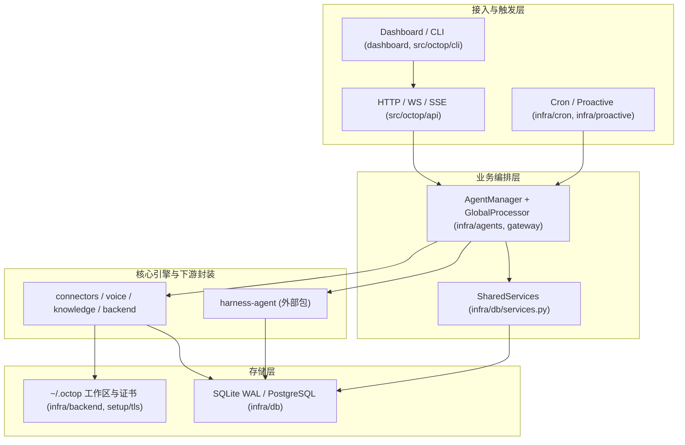

# 系统技术架构

Octop 是**单进程**自托管多用户/多 Agent 平台：一个 Python wheel 内含 FastAPI/WS HTTP 层、Click CLI、React SPA 与 `infra/` 领域核心；无外部队列、无独立 worker，控制面落 SQLite（WAL）或 PostgreSQL，harness 运行时/网关/记忆为外部包。

## 1. 运行时分层与依赖拓扑



| 架构层 | 包含目录 / 文件 | 核心职责 | 越界禁令（Agent 修改红线） |
|---|---|---|---|
| 接入与触发层 | `src/octop/api/`、`src/octop/cli/`、`dashboard/` | 协议解析、JWT/setup 鉴权、Pydantic 校验、SSE/WS 帧 | 禁止直接拼装 SQL 或下游私有字典；router 保持薄 |
| 业务编排层 | `src/octop/infra/{agents,gateway,cron,proactive,users,auth,setup}/` | 用例编排、行级归属、上下游参数转换 | 禁止导入 `api/`、`cli/`、`launch.py` |
| 核心引擎与封装 | `infra/agents/providers/`、`infra/{connectors,knowledge,voice,backend,mobile,desktop,browser}/` | LLM 配置字典、13 类连接器、RAG、语音、设备桥 | 外部域名与凭据走配置项；禁硬编码内部地址 |
| 存储与底座 | `infra/db/`、`infra/utils/`、`config.py`、`i18n/` | 参数化 SQL、迁移、路径/密钥、locale | `infra/utils/` 禁导入其它 `infra/*` 域；repo 只写 SQL |

## 2. 进程启动装配与停机序列（Bootstrap Call Tree）

```text
pyproject.toml:95-96 octop = octop.cli.main:cli
  └─ cli/commands/run.py:153 run -> launch.py:154 run_foreground_blocking -> :56 run_foreground
       ├─ [1. domain] launch.py:74-75 OctopServer() + await srv.start()
       │    └─ server.py:278-326 start()
       │         ├─ :281 paths.ensure_root() + :284 ensure_cli_path()
       │         ├─ :287-289 apply_env_file(env) （先于 load_config）
       │         ├─ :290 _setup_logging() + :291 ensure_mobile_capabilities_probed
       │         ├─ :294-300 ExpertCatalog / SubagentCatalog.refresh()
       │         ├─ :302-307 PluginManager.seed_bundled + load_installed
       │         ├─ :313-317 should_defer_control_plane_db → 向导期提前返回
       │         └─ :319-326 open_database → run_migrations → build_shared_services → _ensure_jwt_secret → _boot_runtime
       │              └─ :353-457 _boot_runtime
       │                   ├─ :364-370 AgentManager
       │                   ├─ :376-386 TrajectoryService + Gateway.boot()
       │                   ├─ :400-419 CronManager + TLS 续期 + 自动备份 system jobs
       │                   ├─ :424-445 ProactiveCareScheduler + UserManager.boot + start_all
       │                   └─ :447-457 AppRuntime + resume_pending_index_jobs
       ├─ [2. http] launch.py:82-100 resolve_tls_paths → build_listen_plan → build_app(srv)
       │    └─ api/app.py:101-308 build_app：异常映射 :78/:93 → CORS :120 → JWT :132 → lockdown :133 → 路由 :201 → SPA :290
       ├─ [3. serve] launch.py:103-148 双 TLS 监听或单 uvicorn；worker=1 强制（双监听/reload）
       └─ [4. shutdown] launch.py:147-151 → server.py:489-506 逆序 shutdown proactive→cron→gateway→agents→users，finally db.close()
```

## 3. 跨切面工程机制速查表

| 机制维度 | 核心符号与源码锚点 | 全局实现规则 |
|---|---|---|
| 认证鉴权与归属 | `resolve_user_from_token` (`api/deps.py:137`)、`_lockdown` (`middleware/setup_lockdown.py:22`) | JWT HS256 + 行级 `agents.user_id` 归属；零用户锁 503；admin 豁免（`deps.py:217`） |
| 并发与线程卸载 | `AsyncIOScheduler` (`cron/manager.py:65`)、`run_in_executor` (`knowledge/jobs.py:63`)、`asyncio.Lock` (`backup/auto.py:42`) | 全 asyncio；阻塞 IO 必须卸载；同一资源互斥（详见 [`core-engine.md`](../architecture/core-engine.md)） |
| 配置与覆盖 | `load_config` (`config.py:394-582`)、`apply_env_file` (`utils/env_file.py:87-92`) | CLI > env > `~/.octop/env` > `config.json` > 默认值（详见 [`configuration.md`](../contracts/configuration.md)） |
| 缓存与指纹 | `fingerprint_mcp_spec` (`connectors/mcp_tool_cache.py:12-94`)、i18n `lru_cache` (`i18n/loader.py:24-41`) | MCP spec 指纹 sha256[:16]；语言包进程内缓存 |
| 异常到协议状态 | `_octop` / `_unhandled` (`api/app.py:78,93`)、`ErrorCode` (`infra/errors.py:13-104`) | 91 个错误码统一 `{error:{code,message,details}}` 包络（详见 [`error-codes.md`](../contracts/error-codes.md)） |
| 外部边界与降级 | `row_to_backend_spec` (`backend/adapter.py:44-168`)、`ensure_bubblewrap` (`utils/bwrap.py`) | 外部服务未配置时 agent 置 `failed` / 检索降级空串 / bubblewrap degraded 不阻断（详见 [`boundary.md`](../operations/boundary.md)） |

完整组件清单见 [`architecture/index.md`](../architecture/index.md)，主干执行流见 [`callchain-panorama.md`](callchain-panorama.md)。

## 4. 导航与维护

业务域与不变量见 [业务架构全景](business-architecture.md)，上下游双向拓扑见 [集成总览](../integrations/index.md)，模块调用边见 [依赖矩阵](../architecture/module-dep-matrix.md)。修改装配顺序时同步复核 [部署运行时](../operations/deployment-and-runtime.md) 与 [边界声明](../operations/boundary.md)。
