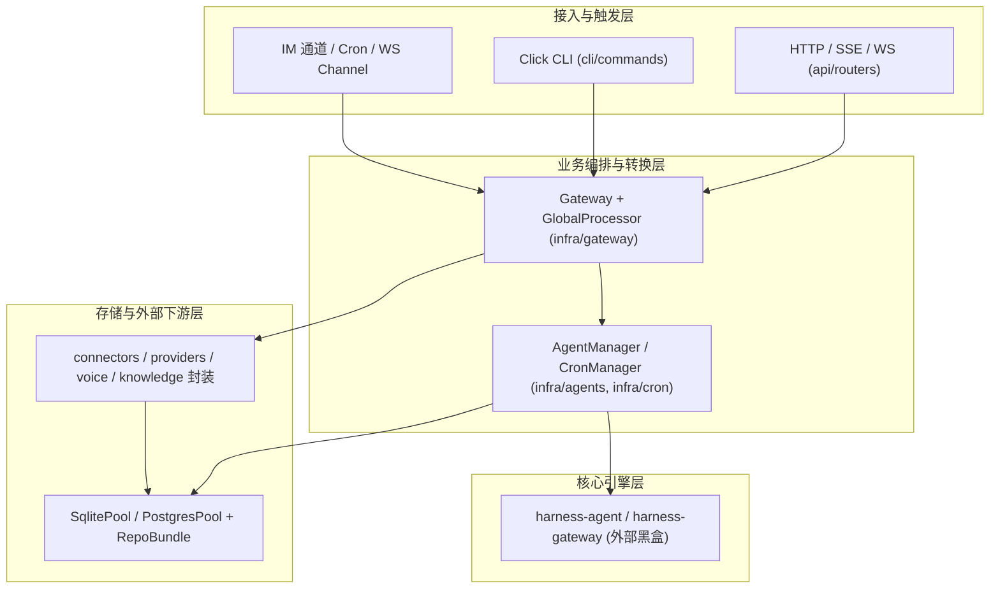

# 系统技术架构

Octop 是单进程自托管 AI 助手：`FastAPI + uvicorn` 承载 Web/HTTP/SSE/WS 与 IM 通道，`Click` 承载离线/嵌入/外部三态 CLI，全部状态重建于 `~/.octop/octop.db`（SQLite WAL 或 PostgreSQL）。分层红线为「传输层向内调用领域层，`infra/` 禁止反向依赖 `api/`/`cli/`/`launch.py`」，唯一允许同时导入 `infra.server` 与 `api.app` 的组装根是 `src/octop/launch.py`。

## 1. 运行时分层与依赖拓扑



| 架构层 | 包含目录 / 文件 | 核心职责 | 越界禁令（Agent 修改红线） |
|---|---|---|---|
| 组装根 | `src/octop/launch.py`、`src/octop/cli/commands/run.py` | 拉起 `OctopServer`、装配 uvicorn、停机清理 | 禁止写 HTTP 路由、SQL 或 CLI 参数解析（`AGENTS.md` launch.py 约束） |
| 接入层 | `src/octop/api/`、`src/octop/cli/` | JWT 鉴权、Pydantic 校验、SSE/WS 帧、错误映射 | 禁止直接拼 SQL 或把领域规则写进 router |
| 编排层 | `src/octop/infra/gateway/`、`infra/agents/`、`infra/cron/` | 统一消息处理、Agent 生命周期、任务调度 | 禁止耦合外层 FastAPI/CLI 对象 |
| 持久化层 | `src/octop/infra/db/`、`infra/backend/` | 参数化 SQL、迁移、工作区后端解析 | 传输外部地址与凭据一律走配置项 |
| 外部黑盒 | `harness-*`、`orcakit-harness-agent` | 模型路由、工具执行、IM 协议桥接 | 本仓不含其服务端实现，禁止推测内部字段 |

## 2. 进程启动装配与停机序列（Bootstrap Call Tree）

```text
pyproject.toml:96 octop = "octop.cli.main:cli"
  -> src/octop/__main__.py:8 cli()
  -> src/octop/cli/main.py:115 cli() (_LazyCLI 懒加载 COMMANDS, src/octop/infra/connectors/gateway/registry.py:6)
  -> src/octop/cli/commands/run.py:153 run() -> _run_uvicorn (src/octop/cli/commands/run.py:16)
  -> src/octop/launch.py:154 run_foreground_blocking -> asyncio.run(run_foreground) (:156)
       ├─ [1. server]   src/octop/launch.py:74  OctopServer() -> src/octop/infra/server.py:240 __init__ (WizardTokenStore ttl=300, :249)
       ├─ [2. start]    src/octop/launch.py:75  await srv.start() -> src/octop/infra/server.py:278
       │    ├─ paths.ensure_root / ensure_cli_path / apply_env_file / _setup_logging (:281-290)
       │    ├─ config = ensure_mobile_capabilities_probed(...) -> load_config (:291-292)
       │    ├─ ExpertCatalog.refresh / SubagentCatalog.refresh / PluginManager.seed_bundled (:294-307)
       │    ├─ [guard: 空库] should_defer_control_plane_db -> _emit_wizard_password(:313-315) 直接返回
       │    └─ open_database / run_migrations / build_shared_services / _ensure_jwt_secret (:319-322)
       ├─ [3. runtime]  src/octop/infra/server.py:353 _boot_runtime
       │    ├─ AgentManager (:364) + TrajectoryService (:376) + Gateway.boot (:381-386)
       │    ├─ CronManager.boot (:405-411) + install_auto_renewal_job / install_auto_backup_job (:415-419)
       │    ├─ registry.boot (:440) + UserManager.boot (:443) + proactive_scheduler.start_all (:445)
       │    └─ AppRuntime 单例 (:447) + resume_pending_index_jobs (:457)
       ├─ [4. bwrap]    src/octop/launch.py:76 _schedule_linux_bubblewrap_ensure (:33)
       ├─ [5. app]      src/octop/launch.py:100 build_app(srv) -> src/octop/api/app.py:101 (中间件 :132-133, 路由 :201-266)
       ├─ [6. serve]    src/octop/launch.py:148 await asyncio.gather(*_serve(...)) -> uvicorn Server.serve
       └─ [7. stop]     src/octop/launch.py:151 await srv.stop() -> src/octop/infra/server.py:489 (:495-502 关闭顺序 + db.close)
```

## 3. 跨切面工程机制速查表

| 机制维度 | 核心符号与源码锚点 | 全局实现规则 |
|---|---|---|
| 认证鉴权与租户隔离 | `install` (`src/octop/api/middleware/jwt_auth.py:32`)、`_assert_agent_owner` (`src/octop/api/common/agent.py:23`) | `Authorization: Bearer` / `access_token` 提取（`src/octop/api/deps.py:112`）；白名单前缀 `src/octop/api/deps.py:66`；用户缓存于 `request.state.octop_user` |
| 会话滑动续期 | `maybe_sliding_renew_token` (`src/octop/api/deps.py:146`) | 剩余寿命 `< 1/3` 时经 `X-Octop-Access-Token` 响应头续签（`src/octop/api/deps.py:61`） |
| 异常到协议状态映射 | `_octop` / `_unhandled` (`src/octop/api/app.py:78`、`:93`) | `OctopError.status` 取自 `_DEFAULT_STATUS`（`src/octop/infra/errors.py:107`），`to_envelope` 本地化 message |
| 并发与阻塞 IO 卸载 | `SqlitePool` (`src/octop/infra/db/pool.py:33`) | 单连接 + `threading.RLock` + `PRAGMA journal_mode=WAL`（`src/octop/infra/db/pool.py:49-50`）；async 函数禁止阻塞 IO，须 `run_in_executor` |
| 依赖注入根 | `SharedServices` (`src/octop/infra/db/services.py:93`) | router 通过 `Depends(get_server)` 取 `server.services.*_repo`（23 个 repo），禁止模块级 import repo |
| 外部边界与默认降级 | `src/octop/infra/backend/resolver.py:23`、`src/octop/infra/connectors/probe.py:422` | 未配置下游时探测返回 `ok=false`；harness 黑盒仅由 `ACPConfig.from_dict` 注入配置（`src/octop/infra/agents/manager.py:2577`） |
| 时区与 i18n | `OctopConfig.default_timezone` (`src/octop/config.py:133`)、`resolve_request_locale` | 服务端文案走 `src/octop/i18n/{en,zh}.json`，用户可见时间以服务端时区格式化 |

## 4. 共变耦合与修改清单（Co-Change Playbook）

1. 变更启动装配顺序：改 `src/octop/infra/server.py:278` / `:353` → 核对 `src/octop/launch.py:56` 的等待点 → 跑 `uv run pytest tests/unit/db tests/unit/cli -q`。
2. 新增全局中间件：在 `src/octop/api/app.py:132-133` 注册 → 补 `src/octop/api/deps.py:66` 白名单 → 验证 `tests/unit/api/` 鉴权用例。
3. 更换数据库驱动：同步 `src/octop/config.py:326` 解析、`src/octop/infra/db/pool.py:144` 的 `PostgresPool` 与成对迁移 SQL，详见 [`module-dep-matrix.md`](../architecture/module-dep-matrix.md) 与 [`deployment-and-runtime.md`](../operations/deployment-and-runtime.md)。
